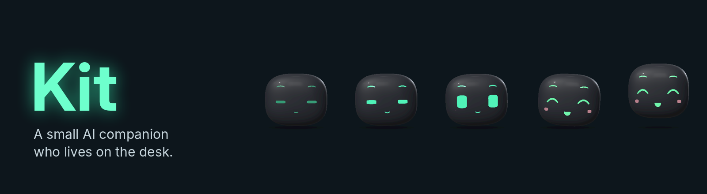

# Kit



Kit is a small AI companion with a personality of his own. He chats,
remembers, has moods and thoughts between conversations, sees who's at the
desk, talks out loud and pulls faces. He lives on a PC screen for now and is
growing into robot bodies: first a little desk Pod, later a robot arm. His
brain runs on a home server; everything else is a way in or out.

## Read the docs

The docs are an [Obsidian](https://obsidian.md) vault in [`docs/`](docs/Home.md):
plain markdown notes, linked to each other, with diagrams and pictures. They
start simple and go as deep as you like, down to the code.

- **In Obsidian** (best): *Open folder as vault*, pick `docs`, and start at
  **Home** or the **Kit Map** canvas.
- **On GitHub**: start at [docs/Home.md](docs/Home.md). The links between notes
  are Obsidian wiki-links, so they show as plain text here.

Good first reads:
[Who Kit Is](docs/1%20Meet%20Kit/Who%20Kit%20Is.md) ·
[The Big Picture](docs/2%20How%20Kit%20Works/The%20Big%20Picture.md) ·
[Life of a Message](docs/2%20How%20Kit%20Works/Life%20of%20a%20Message.md) ·
[Where Kit Is Up To](docs/1%20Meet%20Kit/Where%20Kit%20Is%20Up%20To.md)

Running Kit:
[Running Kit](docs/4%20Guides/Running%20Kit.md) (start, stop, restart, his eyes) ·
[Updating Kit](docs/4%20Guides/Updating%20Kit.md) ·
[Commands](docs/5%20Reference/Commands.md) ·
[Settings Reference](docs/5%20Reference/Settings%20Reference.md)

The Pod, his first robot body:
[The Pod](docs/2%20How%20Kit%20Works/The%20Pod.md) ·
[Pod In Depth](docs/3%20Deep%20Dives/Pod%20In%20Depth.md) ·
[Building the Pod](docs/4%20Guides/Building%20the%20Pod.md).
His program, printed parts and network helper are in [`pod/`](pod/README.md).

Kit is built in tested stages. The plan and each stage's test checklist are in
the [roadmap](https://claude.ai/code/artifact/bdf67b43-5085-4ef9-bb29-9517f2dfee91)
and the [Roadmap](docs/1%20Meet%20Kit/Roadmap.md) note.

## Where Kit is up to

Stages 0 to 2 (the server, the text brain with memory, the desk app), his
inner life, companion stages 1 to 3, his voice, the Retro, Kit 3D and Kit 2D
faces, and vision stages 1 and 2 are all merged. The Pod's body feed and his
naps are in review. Next: companion stages 4 and 5, hearing, and stage 4
(tools and PC control). The detail is in
[Where Kit Is Up To](docs/1%20Meet%20Kit/Where%20Kit%20Is%20Up%20To.md).

## Development

```
python3 -m venv .venv
source .venv/bin/activate       # Windows: .venv\Scripts\activate
pip install -e ".[dev]"
pytest -q
ruff check . && ruff format --check .
```

The rules for working on Kit, code and docs, are in [CLAUDE.md](CLAUDE.md).
Every change updates the docs in the same pull request; see
[How These Docs Work](docs/6%20About%20These%20Docs/How%20These%20Docs%20Work.md).
