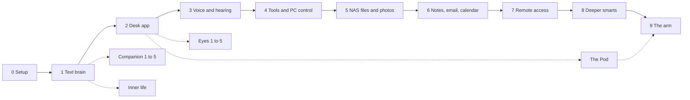

# Roadmap

Kit is built in stages. Each stage has a test checklist, and the next stage
doesn't start until the current one passes. The whole assistant comes first,
on screen; the robot bodies come after. The working plan, with every stage's
checklist and the decisions still open, is the
[roadmap document](https://claude.ai/code/artifact/bdf67b43-5085-4ef9-bb29-9517f2dfee91).
What's actually built is in [[Where Kit Is Up To]].

## The main stages

| Stage | What it adds | State |
|---|---|---|
| 0 Setup | Ubuntu on the GPU PC under WSL, Ollama, Tailscale, NAS mounts, API key, `kit check` | Done: [[Stage 0 - Server Setup]] |
| 1 Text brain | Chat in a browser or terminal, memory, the register of things, local and cloud models, settings with undo | Done: [[Stage 1 - Text Brain]] |
| 2 Desk app | Tray icon, floating face, chat, Kit's window, what's on the PC, the Chrome extension | Done: [[Stage 2 - Desk App]] |
| 3 Voice and hearing | Part 1, his voice: done ([[Stage 3 - Voice]]). Part 2, hearing: microphone, his name as the wake word, speech to text, built as companion stage 5 ([[Companion Stage 5]]) | Part 1 done, part 2 open (#42) |
| 4 Tools and PC control | A tool loop, opening apps, files and sites, the Claude Code bridge, MCP, Home Assistant, home_app and MetTools ([[Stage 4 - Tools]]) | Started: the tool loop is part A1 |
| 5 NAS files and photos | NAS documents and photos as new memory sources | Planned |
| 6 Notes, email, calendar | Gmail, Google Calendar, a daily brief (notes are already in) | Planned |
| 7 Remote access | The phone as a first-class way in, notifications: the [[Phone App]] | Phase 0 (pairing, hello) open |
| 8 Deeper smarts | Computer use and bigger jobs | Planned |
| 9 The arm | Kit in a desk robot arm | Planned |

## Side stages

Some work runs beside the main line because it makes Kit feel alive sooner:

- **Inner life**: feelings, thoughts, a notebook, nightly reflection. Done:
  [[Side Stage - Inner Life]].
- **Companion**: stages 1 to 3 done ([[Companion Stage 1]],
  [[Companion Stage 2]], [[Companion Stage 3]]); stage 4 open
  ([[Companion Stage 4]]); stage 5, hearing, next.
- **Eyes**: stages 1 and 2 done ([[Vision Stage 1]], [[Vision Stage 2]]).
  Still to come: gestures and moods, a proper look at a still frame with a
  vision model, and eyes on a Raspberry Pi at the arm.
- **The Pod**: Kit's first robot body. See [[The Pod]] and [[Building the Pod]].

## Ideas waiting for a stage

Things asked for that aren't built yet live in [[Ideas and Improvements]].
