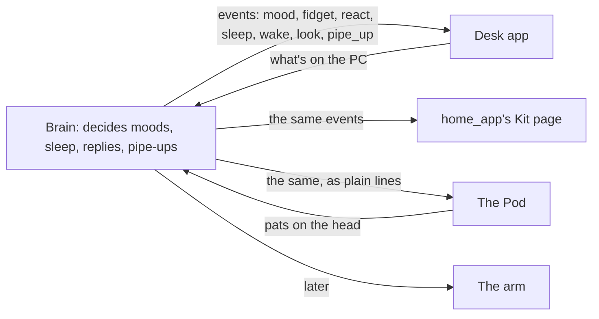

# Bodies

> [!ABSTRACT] In short
> There's only ever one Kit: one brain, one memory, one mood. A **body** is
> just where he is, like a person walking between rooms. Every body listens to
> the brain's events and acts them out its own way, and tells the brain what
> it senses. The brain never moves into a robot; a body only adds reflexes,
> like blinking. The desk app is his first body, the **Pod** is his first
> robot, and the **arm** comes last.

## How a body works

- Bodies listen to `GET /api/life/events`: fidgets, reactions, sleeping and
  waking, mood changes, pipe-ups, and `look` events saying where the person his
  eyes see is. See [[API]].
- Each body draws his face from the same **character sheet**, picking the look
  its `use` table names (`desk`, `home_app`, `robot`). See [[Face]].
- Each body plays the same **gestures** and **body moves** by name, scaled to
  what it can do.

## The desk app

His body on the Windows PC: a floating face, a chat, a voice. See [[Desk App]].

## home_app

Dan's home website has a Kit page: his face (2D or the 3D page, proxied from
the brain), how he's feeling, and a chat on the `home` channel. It reads the
same events and sheet as the desk. See [[Other Apps]].

![[home-app-panel.jpg|420]]

## The Pod

Kit's first robot: a small printed desk Pod with the whole front as his face.
A 1.5" screen shows **Kit 2D**, two hobby servos **turn and tilt** his head,
an **ESP32** runs it over Wi-Fi, and a touch pad on top feels a **pat**. It
reads the brain's **body feed**, plain lines like `emotion happy`, so a small
board can act Kit out without a JSON library. Its program and print files are
in the repo under `pod/`. See [[The Pod]].

| | |
|---|---|
| ![[pod-v2-hero.jpg]] | ![[pod-v2-inside.jpg]] |
| The Pod | Inside: screen, tilt servo, turn servo, ESP32 |

His neck stays calm: the face is as lively as on the desk, but the head only
moves for a glance round the room, something catching his eye, a real gesture
or his mood's posture. Fidgets stay on the screen.

> [!NOTE] In progress
> The brain's side of the Pod (the body feed, pats, and Kit knowing who in the
> room can hear him) is pull request #36. Next: a speaker and microphone in
> the Pod, so he can talk and listen in the room, one voice at a time.

## Who can hear him

Kit is one mind wherever you reach him, but how he talks depends on who can
hear. **Out loud** (his voice at the desk, or the Pod) anyone in the room hears
him, so he's told who his eyes see there, people and pets, and talks to them
directly: "Hi Sam!", or "Milo, you'd better not eat me." **On a screen** only
Dan reads him, so a hello for someone else goes through Dan: "tell Sam I said
hi."

- A message can say **who sent it**, so a visitor can talk to him themselves.
  Out loud, if nobody says, it's the one person his eyes know in the room (when
  that isn't Dan). The history keeps it: "(Sam said) hello Kit".
- A pet gets its name when it's in the [[Register of Things]] as a pet with its
  kind (like "cat") in its description, and it's the only pet of that kind.
- When his first words are for someone in the room, bodies get a `turn_to`
  line and face them while he talks. See [[Pod In Depth#The body feed]].

## The arm

The last stage: Kit in a desk robot arm, with his face on a small screen in
its head and the brain still on the server. A Raspberry Pi at the arm runs the
motors and, later, his eyes. Recorded moves are scaled by his mood and a
little noise, so no two look the same.

![[arm-concepts.png]]

*Four directions explored for the arm. Nothing is decided yet.*

| Kit's state | On the screen now | On the arm later |
|---|---|---|
| Asleep, you're away | eyes close, slides down the screen | lies down flat, slow breathing |
| You come back | startles, perks up | lifts its head, stretches, turns to you |
| Bored | sighs, looks around | taps the desk, peers at things |
| Curious | peeks at your window | leans toward the monitor, tilts its head |
| Sulky | sighs, looks away | turns away a little, droops |

## Go deeper
- [[The Pod]], [[Pod In Depth]] and [[Building the Pod]]: Kit's first robot.
- [[Inner Life In Depth]], under "One brain, many bodies" and "The arm".
- [[Face In Depth]], under "On the arm" and Kit 2D's shapes for painter ports.
- [[Roadmap]]: when each body comes.

> [!under-the-hood]- Under the hood: the code
> - `src/kit/life.py`: the events every body hears.
> - `src/kit/body.py`: the plain-text body feed, chat moments and pats.
> - `src/kit/audience.py`: who can hear him, and who his words are for.
> - `src/kit/face/body.py`: body moves by name.
> - `src/kit/face/characters/kit2d.json`: the `kit2d_screen` look the Pod draws.
> - `src/kit/desk/alive.py`: how the desk acts out sleep, waking and glances.
