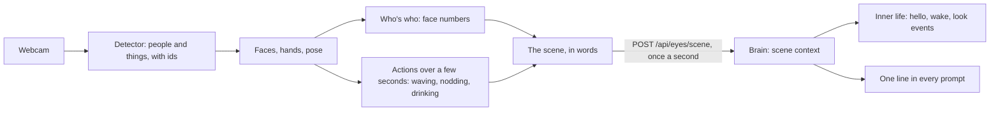

# Eyes

> [!ABSTRACT] In short
> A small program, `kit eyes`, runs on the PC with the webcam. It finds
> people and things, reads faces, hands and poses, and about once a second
> tells the brain **in words and numbers** what it sees: who's at the desk,
> where they are, what they're doing, what just happened. **Never a picture.**
> The brain keeps that as a scene, the way it keeps what's on your PC. People
> you've introduced are recognised by name.

## What it lets Kit do

- **Know you're there** even when you're only reading, so he doesn't doze off.
- **Say hello** when someone sits down after the desk was empty a while, by
  name if he knows them.
- **Look at you**: his face's eyes follow yours, and the Pod turns to you.
- **Notice things**: the cat wandering in, a wave, a thumbs up, a cup in your
  hand. They go into his thoughts, and arrivals and animals into his memory
  (`seen`), so "when did I get in this morning?" has an answer.
- **Have a proper look** when you ask ("what am I holding?") with the
  `look_around` action. In `cloud-only` routing that look goes to the cloud
  chat model, as words ([[Privacy#What a cloud model sees of your PC and the room]]).
- **Mind his manners**: no pipe-ups while you're on your phone or talking to
  someone, and nothing said out loud to an empty room.

## Moments he feels

With `life.seen_feelings` on, a few small moments become feelings with a
cause, the way something you say does. They have to be held long enough to
be real, and each has a wait before it can come again, so a long smile is one
moment, not sixty:

| You | He | Feels |
|---|---|---|
| Wave | Waves back | Pleased |
| Thumbs up (two reports running) | Nods | Proud |
| Thumbs down | Droops | A bit put out |
| Smile at him for two seconds | A little wiggle; brightens with the mood dials | Pleased |
| Frown in four of five reports | Leans in, and has a thought about it | Sympathetic |
| Eyes closing late at night | Yawns; bed is on his mind an hour sooner | |

Only you count: by name, or the one person in view his eyes can't put a name
to (it's your desk). While he's asleep his eyes are shut, so nothing does.
More in [[Inner Life In Depth#Busy and held pipe-ups]] and
[[Companion Stage 4]].

## How it works



- **Detector**: YOLO11 finds people and objects, and ByteTrack keeps their ids
  from frame to frame. It runs on the PC's GPU, or on the CPU: see
  [[#Without a graphics card]].
- **Faces, hands and pose** come from MediaPipe: where someone's looking,
  their expression, hand gestures, body pose.
- **Actions** like nodding, waving, talking and drinking come from a few
  seconds of movement, not one frame.
- **Who's who**: introduce someone with `kit eyes enrol NAME` and a ready-made
  face model keeps a few dozen sets of 128 numbers from their face. No picture
  is kept, and a face can't be rebuilt from the numbers. `kit eyes forget NAME`
  deletes them.
- **Settings come from the brain** (`[eyes]`), so there's one place to change
  them, and running eyes pick changes up.
- **Reports go from their own thread**, so a slow or absent brain never holds
  up the camera loop (a stall used to drop tracks, and with them who was who).
  A newer report takes the place of one still waiting, and the events of a
  report that didn't get through ("Dan sat down", "waved") go with the next
  one that does, up to the hundred the brain takes in one report.

## Without a graphics card

The eyes don't need a GPU. "Lite eyes" look 5 times a second instead of at
every frame, run a small detector at a smaller size through OpenVINO (the
quick way on an Intel CPU), and let the detector rest between looks while the
face reader keeps up, so his eyes still follow you. That's enough for hellos,
who's who, following your face and spotting the cat. Small things across the
room get missed more often.

```
pip install -e ".[eyes,eyes-cpu]"         # in the eyes' venv: adds OpenVINO
kit config set eyes.device cpu
kit config set eyes.detector yolo11n
kit config set eyes.detector_format openvino   # ncnn on a Raspberry Pi
kit config set eyes.detector_size 320
kit config set eyes.width 640
kit config set eyes.height 360
kit config set eyes.looks_per_second 5
kit config set eyes.detect_every 3
kit config set eyes.poses 0
```

Then restart `kit eyes`. The first start makes the OpenVINO copy of the
detector (about a minute, once). What it costs, measured on two cores of a
recent server CPU held to the same instructions as a desktop from 2013 (expect
about half as fast again on an old i5, so roughly half a core for lite eyes):

| Setup | Looks a second | CPU |
|---|---|---|
| Today's settings with no GPU (yolo11n at 640, every frame) | about 6 | 120% of a core |
| Lite eyes, as above | 5 | 35% of a core |
| Lite eyes with `eyes.hands` off too | 5 | 19% of a core |

If the runtime for a format isn't installed, `kit eyes` stops and says what to
install rather than fetching it behind your back.

> [!NOTE] A Raspberry Pi
> Lite eyes get part of the way to a Pi. On a Pi 5 use `ncnn` (`pip install
> ncnn pnnx`; it's built for ARM chips) and the detector should take tens of
> milliseconds a look. `onnx` works anywhere but kept the CPU busier than
> OpenVINO in the same test. What's still in the way: the eyes run through
> Ultralytics, which brings PyTorch with it (about a gigabyte; fine on a Pi 5,
> not a Pi 4 or a Zero), and making the NCNN copy on the Pi itself is slow.
> The Pi path when a Pi is real: export the detector on the PC and copy the
> `_ncnn_model` folder into the eyes' models folder (an export already there is
> used as is), and an Ultralytics-free NCNN runner so PyTorch stays off the Pi.

## The switch

**Let Kit see me** in the desk app's tray menu (or `kit eyes pause`) turns the
eyes off: the camera is released, and Kit is told he can't see, so he never
pretends to. The brain keeps the switch across restarts. See [[Privacy]].

## Try it

```
kit eyes cameras        # which cameras this PC has
kit eyes --show         # a window with boxes, faces and the scene in words
kit eyes                # every day, headless
kit eyes show           # what Kit can see right now, as he's told it
kit eyes enrol me       # introduce yourself; NAME for anyone else
kit eyes faces          # who his eyes know
```

## Go deeper
- [[Vision Stage 1]]: installing the eyes, privacy and the test checklist.
- [[Vision Stage 2]]: introducing people, and how recognition works.
- [[Settings Reference#eyes]]: every eyes setting.
- [[Inner Life]]: what the brain does with arrivals and sightings.
- [[Companion Stage 4]]: moments he feels, and keeping quiet while you're busy.

> [!under-the-hood]- Under the hood: the code
> - `src/kit/eyes/`: the camera side: `camera`, `detect`, `faces`, `body`,
>   `actions`, `recognise`, `enrol`, `scene`, `run`, `link`, `preview`.
> - `src/kit/scene_context.py`: the brain's side: the latest scene, the day's
>   comings and goings, the prompt line and `look_around`.
> - `src/kit/known_faces.py`: the people Kit has been introduced to.
> - `src/kit/noticing.py`: the moments he feels (waves, smiles, frowns).
