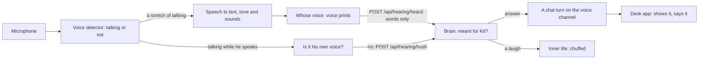

# Hearing

> [!ABSTRACT] In short
> A small program, `kit hearing`, runs on the PC with the microphone. It
> listens for talking, turns it into **words** on that PC, notes how it
> **sounded** (cheerful, down, cross, a laugh) and **whose voice** it was,
> and sends the brain only that. **Sound never leaves the PC.** Say his name
> and he answers out loud; answer him and he carries on; talk over him and he
> stops. Talk that isn't meant for him is let go: not kept, not sent on, not
> even written in the log.

## What it lets Kit do

- **Talk across the room.** "Kit, what's the weather doing?" from the couch
  gets an answer out loud, shown in the desk chat like a typed one.
- **Keep a conversation going.** For a few seconds after he stops talking
  (`hearing.follow_up_s`), you can answer without his name.
- **Stop when you talk over him,** as he does when you type.
- **Enjoy a laugh.** A laugh just after he says something makes him chuffed,
  "because you laughed".
- **Hear how you sound.** If you sound down he's gentler, and he may ask how
  you are. He never tells you how you feel: it's a guess from a sound.
- **Know who's talking.** Introduce someone with `kit hearing enrol NAME` and
  he answers them as themselves, not as you.
- **Wake up when you call him.** His name wakes him from a nap. Talk he only
  overhears never does, and neither does the camera.

## How it works



All three models run on the PC's processor through sherpa-onnx (no graphics
card, no PyTorch), and are downloaded the first time:

| Model | What it does |
|---|---|
| **Silero VAD** | Tells talking from silence and noise, 32 ms at a time |
| **SenseVoice-Small** | Speech to text, with the tone of voice and sounds like a laugh, in one pass; about half a second for seven seconds of talking |
| **CAM++** | A voice print: 512 numbers for whose voice it is |

### When he answers

The brain (`kit.heard`) decides what each stretch of talking means:

| Heard | He... |
|---|---|
| His name at the start or end: "Kit, ...", "hey Kit ...", "..., Kit?", "what's it doing Kit", "thanks Kit" | answers |
| Anything in the few seconds after he stops talking | answers: you're answering him |
| A laugh soon after he said something (`hearing.laugh_s`) | is chuffed |
| His own voice, or words he just said | ignores it: that's the speakers |
| Anything else ("I told Kit yesterday", the TV) | lets it go |

His name is short, so the ears keep the moment of sound just before the voice
detector notices talking: that's where "Kit, ..." usually is. Speech to text
sometimes writes it "Ki", "Kid" or "Kitt", so those count too
(`hearing.names`). A name at the end only counts when it's said to him, not
about him: "I told Kit" and "the first aid kit" don't.

An answer is an ordinary chat turn on the **voice channel**, so he keeps it
short and spoken. It starts on the brain straight away, and the desk app reads
it as it's made (the `heard` event says which turn), so he starts talking as
fast as he does to a typed message.

### Talking over him

While he's talking, the ears voice print the latest second and a half of
anything that sounds like talking, every `hearing.barge_in_ms`. If it isn't
his own voice, they tell the brain, which sends every body a `hush`: the desk
app stops his voice at once and shows the rest of his words. Then he hears you
out and answers.

### His own voice

Without a headset, his voice comes back through the mic. Two things stop him
answering himself:

- **His voice print.** When the ears start, and whenever his voice engine
  changes, they ask the brain for a line in his voice (never played) and learn
  its print. A stretch that sounds like him is flagged, and never stops him.
  With his voice off there's nothing to learn, and talking over him is off
  too.
- **His words.** Anything heard just after he spoke that's mostly the same
  words as what he said is dropped.

A headset, or a mic with echo cancelling, makes both easier.

### Whose voice

`kit hearing enrol NAME` has someone read a few lines aloud. Each few seconds
of their talking becomes a **voice print**, 512 numbers from which no sound
can be rebuilt, kept in his data folder (`state/voices.json`). A heard voice
close enough to someone's prints (`hearing.match`) is them. Someone who isn't
you is answered by name, their lines are marked "(Sam, out loud)" in his
history, and what they say about themselves isn't learned as a fact about you.
`kit hearing forget NAME` deletes them.

### Tone and laughs

SenseVoice reads a tone from how something sounded: happy, sad, angry,
fearful, surprised. A tone gives him a light feeling (sympathetic when you
sound down, pleased when you sound cheerful) and a line in his prompt to ask
lightly, once, if it matters. Turn it off with `hearing.tone`.

## The switch

**Let Kit hear me** in the desk app's tray menu (or `kit hearing pause`) turns
the ears off: the mic is let go, and Kit is told he can't hear, so he never
pretends to. The brain keeps the switch across restarts. See [[Privacy]].

## Try it

```
kit hearing mics        # which microphones this PC has
kit hearing             # run the ears; Ctrl+C stops them
kit hearing --words     # the same, showing the words they hear (only in that window)
kit hearing enrol me    # introduce your voice; NAME for anyone else
kit hearing show        # listening or not, and what he last made of something
```

## Go deeper
- [[Companion Stage 5]]: installing the ears, and the test checklist.
- [[Voice]]: his side of the conversation.
- [[Eyes]]: the same idea for the camera.
- [[Inner Life]]: what a laugh or a tone does to how he feels.

> [!under-the-hood]- Under the hood: the code
> - `src/kit/hearing/`: the mic side: `mic`, `engines`, `models`, `run`,
>   `enrol`, `link`.
> - `src/kit/heard.py`: the brain's side: meant for Kit or not, echoes, the
>   follow-up window, tone lines, heard turns.
> - `src/kit/known_voices.py`: the people Kit knows by voice.
> - `src/kit/desk/chat.py`: shows what was heard and his reply, and stops his
>   voice on a `hush`.
