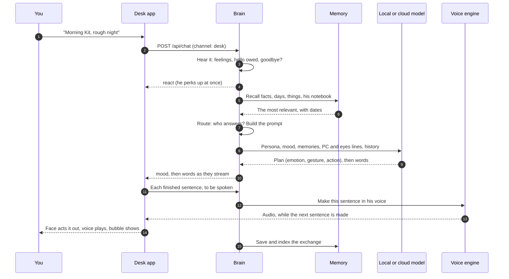

# Life of a message

> [!ABSTRACT] In short
> You type "Morning Kit, rough night". Before a word comes back, Kit has
> noticed you're back, felt a bit worried about you, searched his memory,
> picked who should answer, and put together everything he knows about right
> now. His answer streams out as words, a mood and a gesture; the desk app
> plays the face and says it out loud a sentence at a time. Afterwards the
> exchange goes into memory, and tonight it becomes part of his day.

## The journey

## Step by step

1. **It arrives with where it came from.** Every message names its channel:
   the desk app, the chat page, your phone, home_app, the terminal or voice.
   Kit is told, so on the phone he keeps it short and at the desk "this"
   means what's on screen. See [[Brain#Where you're talking from]].
2. **He hears it before he answers.** Words like "legend", "stressed" or
   "rough night" give him a feeling with a reason. A goodbye is noted, a hello
   he owed you is folded in, and a quick **reaction** goes to the face straight
   away (a perk, a wave, a wiggle) so you can see he heard. See [[Inner Life]]
   and [[Companion]].
3. **Quick answers skip the model.** "Yes" to a suggested note, a "shush", or
   a yes to a new entry in the register get answered on the spot.
4. **He looks things up while he thinks.** If you asked the time or the
   weather, a **show** for his face is fetched in parallel. A weather question
   for the local model starts the **forecast** lookup now too, rather than
   after recall. A plain request about your notes is spotted in a thread
   meanwhile ([[Notes on the NAS#Reading your notes]]). If you put a fact
   to him ("Sydney's the capital, isn't it?"), the work model checks it in
   the background.
5. **Recall.** His memory is searched by words and by meaning: up to 8 facts
   or day summaries, 4 old conversation snippets, 5 entries from the register
   of things and 3 notes from his own notebook. Pinned facts are always in.
   Your message is turned into a meaning vector **once** a turn: the new-topic
   check and recall share it. See [[Memory]].
6. **Route.** The routing mode picks who answers: the local model, the cloud
   chat model, or the work model; "keep it local", "ask Claude" and "think
   hard" choose for one message. Bad news that hits hard is a **key moment**
   and goes to the work model, as Kit. See [[Models and Routing]].
7. **The prompt.** The model sees who Kit is (his self-sheet and persona), how
   he feels and why, how long since you talked, how close you two are, the
   channel, one line about your PC, one line about what his eyes see, the
   recalled memories and things, and the recent conversation. The part that
   changes every turn (the time, his mood, the memories) goes in front of your
   message rather than in the instructions, so the instructions and the
   conversation read the same as last turn and a cloud model serves them from
   its cache. See [[Models and Routing#Caching]].
8. **The answer.** The local model answers in two passes: a quick plan in JSON
   (emotion, gesture, action), then his words in plain text, streamed as they
   come. A cloud model answers in the same shape, streamed too, so he starts
   talking as soon as its first words arrive (`cloud.stream`). Either way the
   reply has **words**, an **emotion**, **gestures**, maybe an **action**, and
   maybe some **detail** to read on screen (code, steps, a link).
9. **Actions.** If the plan says so, Kit does something and answers again
   with what he found: `recall` searches memory harder, `look_at_pc` reads the
   full picture of your PC, `look_around` reads everything his eyes see,
   `weather` gets the forecast, `ask_cloud` or `ask_expert` hands the question
   up. `remember`, `note` and `thing` save something. See [[Brain#What he can do mid-answer]].
10. **Out to the body.** Events stream back: his mood first, then his words,
    then `spoken` as soon as his words are complete (so his voice doesn't wait
    for the screen detail), then the finished reply. The desk app plays the
    emotion and gesture on his face, shows the words, and speaks each sentence
    as soon as it's whole. See [[Desk App]], [[Face]] and [[Voice]].
11. **Afterwards.** The exchange is saved and indexed so it can be found
    later, and a "remember that..." is learned, both in the background once
    the reply is out, so the chat never waits for them; the bodies get a
    `remembered` event when it's done. Everything else waits for tonight's
    day summary and his reflection. See [[Memory]] and [[Inner Life]].

> [!TIP] Kit keeps talking while he works
> A slow cloud answer runs as its own task. Ask "how's it going?" meanwhile
> and the local model answers, knowing what's in progress and for how long.
> The slow answer turns up when it's ready, marked with its question.

> [!under-the-hood]- Under the hood: the code
> - `src/kit/server.py`: `POST /api/chat` streams the events.
> - `src/kit/brain.py`: `Brain.chat` and `_run_turn`, the whole journey above.
> - `src/kit/recall.py`, `src/kit/prompt.py`, `src/kit/reply.py`: recall, the
>   prompt and the shape of a reply.
> - `src/kit/desk/chat.py`, `src/kit/desk/voice.py`: the desk side.
