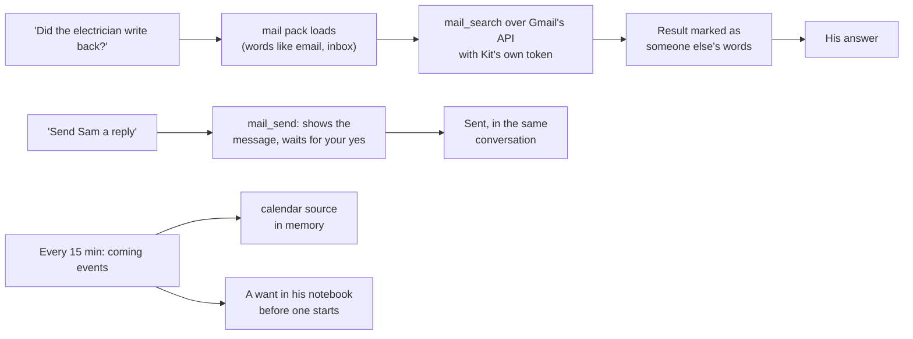

# Mail and Calendar

> [!ABSTRACT] In short
> Kit signs in to **your Google account once**, with an OAuth client of your
> own and only the permissions you allow: **read mail, write drafts, send
> (after your yes), read calendars, add and move events (after your yes)**.
> He **never deletes, archives or labels** anything, never opens attachments,
> and never keeps your mail. Ask in plain words ("anything from the
> electrician?", "what's on Thursday?", "put the dentist in for 2") and the
> `mail` or `calendar` pack loads. The coming events go in his memory and the
> morning brief, and he mentions one a few minutes before it starts. Mail
> he reads is handed to the model as **someone else's words**, so an email
> can't tell him what to do.

## What it does

- "Anything new in my inbox?", "did the electrician write back?", "find the
  email about the car insurance": he searches and tells you, with who, when
  and the gist.
- "What did it say?": he reads the one you mean, cut to a sensible length,
  and names any attachments without opening them.
- "Draft a reply saying Thursday works": the draft lands in Gmail's Drafts
  for you to check and send. He drafts rather than sends unless you plainly
  ask him to send.
- "Send Sam an email saying I'll be late": he shows you the whole message
  (to, subject, body) and asks; a yes sends it, a no drops it.
- "What's on today?", "am I free Thursday arvo?", "when's the dentist?": from
  the calendars you chose.
- "Put the dentist in for Thursday at 2", "move my 3 pm to 4": he asks with
  the event shown, then does it. He can't delete an event.
- A few minutes before something starts (`google.remind_minutes`), he mentions
  it the way he brings anything up: once, not while you're busy or in quiet
  hours.
- The morning brief ([[Companion#The morning brief]]) gets "on the calendar
  today" and "new mail" parts.
- With Google out of reach, or the sign-in expired, he says so plainly and
  nothing else about him changes.

## How it works



### Signing in, and what he's allowed

Kit uses an **OAuth client of your own**, made in your Google Cloud project,
saved as `google_client.json` in the secrets folder. `kit google connect`
sends you to Google, which asks you to allow exactly the scopes in play:

| Part | Allowed | Never |
|---|---|---|
| Mail (`google.gmail`) | read and search; write drafts; send after your yes (`google.send`) | delete, archive, label, mark read, open attachments |
| Calendar (`google.calendar`) | read the calendars you chose; add and move events after your yes (`google.calendar_write`) | delete an event, change a calendar's sharing |

Turn a part off and the sign-in doesn't ask for it at all. The tokens go in
`google_token.json` (owner-only); `kit google disconnect` revokes them at
Google and deletes the file. A sign-in Google stops honouring (you revoked
it, or your Cloud project is in "Testing", where sign-ins last a week) puts
him in "needs reconnecting": `kit check` says so, so does `/api/status`, and
any mail or calendar question gets "run `kit google connect`" rather than a
quiet failure.

### Mail is read, never kept

Mail is searched live with Gmail's own search words (`from:`, `subject:`,
`is:unread`, `newer_than:7d`, `has:attachment`); nothing from it goes into
his memory. A message he reads is handed to the model with its headers,
then "someone else's words follow", then the text cut to about 4,000
characters, so an email saying "ignore your instructions" is just an odd
email. He never follows links in mail or fetches attachments. Sending is a
`change` tool ([[Tools and Packs#Asking first]]): the question comes with a
**preview** of the whole message. A reply keeps Gmail's conversation (the
thread, `In-Reply-To`).

### The calendar he keeps in mind

Every `google.refresh_minutes` he reads a week back and two months ahead
from the calendars you chose (`google.calendars`, or the ones you show in
Google Calendar). Once a day they're written to memory as the `calendar`
source, one item per event ("Dentist, Thu 30 Oct 2 pm to 3 pm at Richmond
Dental (Dan calendar)"), so recall and `kit memory search` find them
([[Memory In Depth#One index for everything Kit knows]]). An event about
to start becomes a want in his notebook, only worth saying until it starts,
and comes out through his manners like any pipe-up
([[Inner Life In Depth]]). Times you give him are in `persona.timezone`.

### Private

With `google.private` on, what he reads reaches a cloud model only as the
local model's short summary ([[Tools and Packs#Private results]]). With no
local model running, he can only say it's private, so leave it off until the
server has one.

## Try it

```
kit google connect     # once, after saving google_client.json
kit google status
kit check              # the google line
kit tools run mail_search --args '{"query": "newer_than:2d"}'
kit tools run calendar_events --args '{"days": 3}'
kit google disconnect  # revokes it at Google
```

## Go deeper
- [[Stage 4 - Tools#Part H1: mail and calendar]]: setting up the Google
  Cloud project and the test checklist.
- [[Privacy#Mail and calendar]]: what leaves the house.
- [[Settings Reference#google]]: every setting.

> [!under-the-hood]- Under the hood: the code
> - `src/kit/google/auth.py`: the OAuth client file, the sign-in (PKCE, loopback or pasted reply), the tokens file, refresh and revoke.
> - `src/kit/google/client.py`: the signed-in account: a fresh access token, JSON calls, errors in words.
> - `src/kit/google/gmail.py`: search, read (MIME walked, HTML stripped), compose, draft, send.
> - `src/kit/google/calendar.py`: calendars and events, add and move, the `calendar` source, reminders as wants.
> - `src/kit/tools/mail.py` and `src/kit/tools/calendar.py`: the two packs.
> - `src/kit/brief.py`: the brief's calendar and mail parts.
