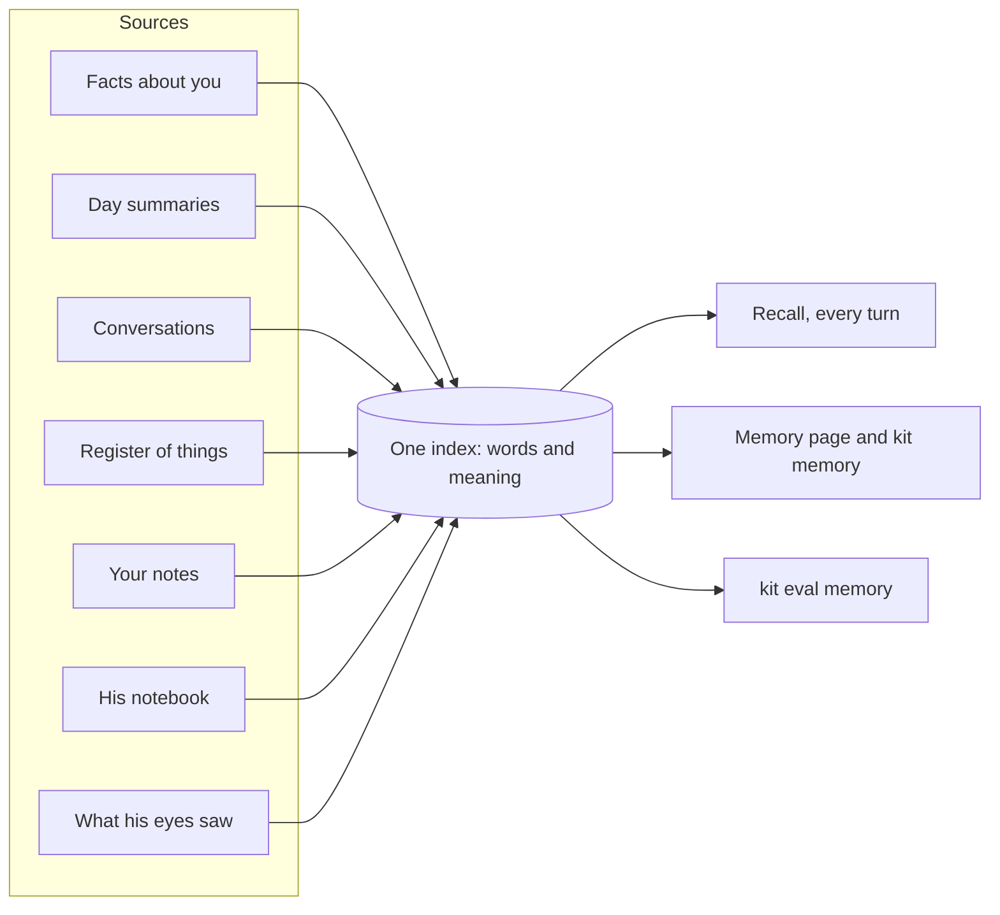

# Memory

> [!ABSTRACT] In short
> Everything Kit can recall lives in **one index**: facts about you, a summary
> of each day, every conversation, the register of things, your notes, his
> own thoughts, and what his eyes noticed. Every message, he searches it **by
> words and by meaning** and puts the best matches in front of the model, with
> their dates. New facts are **compared with old ones**, so "I sold the Hilux"
> replaces the old fact instead of sitting beside it. You can see, search,
> pin, edit and forget all of it.

## What's in it

| Source | What's in it |
|---|---|
| `memory` | Facts about you, by kind: about you, preferences, projects, places, people, plans, how you've been lately |
| `days` | A summary of each finished day |
| `conversation` | Every exchange, so old chats can be found |
| `things` | The [[Register of Things]] |
| `notes` | Your Obsidian notes, by heading ([[Notes on the NAS]]) |
| `self` | His own thoughts, opinions, moments and journal ([[Inner Life]]) |
| `seen` | Arrivals after a while and animals wandering in ([[Eyes]]) |

A new kind of thing to remember (files, photos, projects) is added as a new
source in the same index, and recall, search, the memory page and the
accuracy test all cover it with no other change.

## Finding things

Every search runs two ways at once and merges the results:

- **By words**, with SQLite full-text search: exact names, numbers, file names.
- **By meaning**, with a small embedding model in Ollama: "where's my tax
  stuff?" finds "tax returns are in Documents/Finance/Tax".

A match only counts if it's close enough in meaning (`memory.min_similarity`),
which is what lets him say "I don't know" instead of guessing. If the
embedding model is down he searches by words alone, and catches up later.

Among relevant facts, the ones that **matter more** (people, things about
you) and the ones **recalled lately** come first, the way a person's memory
works. **Pinned** facts are always in mind.

## Learning without a mess

A new fact is compared with the closest facts he already has, and a model
decides: **same** (nothing added), **update** (the new fact supersedes the
old, which stays in its history), or **new**. Facts come from "remember
that...", from who someone is to you ("Emma's my cousin"), and from the
**end-of-day pass** after midnight, which writes the day's summary and learns
its lasting facts.

Two kinds of fact know about time: **now** facts ("been sleeping badly") fade
after two weeks, and **plans** keep their date, so a past one isn't upcoming.

## Keep it local

Say "keep it local" and that message, and everything Kit learns from it, is
marked private and never goes to a cloud model: not in that turn, not in
recall, not in the nightly reflection. See [[Privacy]].

## You stay in charge

- The **memory page** (`/memory`, or Memory in the desk app's window) shows
  everything, grouped by kind, with search, teach, pin, edit, history and
  forget. Forgetting removes a fact and all its earlier versions.
- `kit memory ...` does the same from a terminal ([[Commands#Memory]]).
- `kit memory tidy` sorts what he knows by today's rules, showing the plan
  first.
- Memory is **backed up** daily to `backups/` in the data folder.
- `kit eval memory` checks accuracy on a scratch memory ([[Evals]]).

## Go deeper
- [[Memory In Depth]]: the full story, every rule and number.
- [[Register of Things]]: facts say what's true; the register says where things are.
- [[Stage 1 - Text Brain]]: setting it up and testing it.

> [!under-the-hood]- Under the hood: the code
> - `src/kit/knowledge.py`: the one index (full-text and vectors, supersede, history).
> - `src/kit/memory.py`: the SQLite file: conversation, facts, days, spend, migrations.
> - `src/kit/recall.py`: what goes into each turn, and the weighting.
> - `src/kit/learning.py`: same, update or new; the end-of-day pass.
> - `src/kit/embed.py`: meaning vectors from Ollama.
