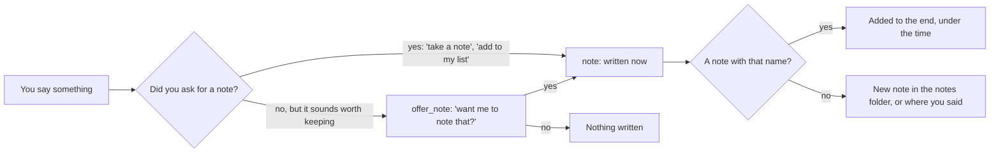

# Notes on the NAS

> [!ABSTRACT] In short
> Your notes are an **Obsidian vault** on the NAS: plain markdown files. Kit
> **reads all of them** into his memory and keeps up with your changes every
> few minutes, so he can answer from them. He **writes a note only when you
> ask** ("take a note", "add milk to my shopping list"), or asks first if
> something sounds worth keeping. The vault is the **only** place on the NAS
> he may change; every other share is read-only.

## Reading your notes

- Every note is split at its headings and added to his memory as the `notes`
  source, so recall and search find the right part of a long note. See
  [[Memory]].
- Every five minutes he picks up new, changed and deleted notes.
- He sees the names of your most recent notes, so "what's in my holiday
  planner?" opens that note (`read_note`) and answers from it.
- Folders starting with a dot (`.obsidian`, `.trash`, Synology's own) are
  skipped.

## Writing a note

He never writes a note unasked. Unrequested notes clutter a vault and feel
random, so anything he might write on his own (notes, and later the
calendar and files) asks first.

## Read-only, except the vault

The NAS user Kit logs in as has **read/write** on the notes share only.
Photos, documents and family shares are **read-only**, set both on the NAS
and in `nas.read_only_shares`, and `kit check` fails any of those shares
he could write to. Nothing else on the NAS changes because of Kit.

> [!NOTE] Coming later
> Photos and documents on the read-only shares will become new memory
> sources too, so he can recall them the same way. See
> [[Memory In Depth]] for how a new source is added.

## Go deeper
- [[Notes Setup]]: giving Kit write access, mounting the share, the settings
  and the test checklist.
- [[Stage 0 - Server Setup]]: mounting the NAS shares read-only.
- [[Memory]]: how notes are found alongside everything else he knows.

> [!under-the-hood]- Under the hood: the code
> - `src/kit/notes.py`: reading the vault, taking notes, `asks_for_note`.
> - `src/kit/checks.py`: the `nas:` lines in `kit check`.
> - Settings: `nas.vault`, `nas.notes_folder`, `nas.read_only_shares`
>   ([[Settings Reference#nas]]).
