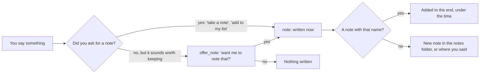

# Notes on the NAS

> [!ABSTRACT] In short
> Your notes are an **Obsidian vault** on the NAS: plain markdown files. Kit
> **reads all of them** into his memory and keeps up with your changes every
> few minutes, so he can answer from them. He **writes a note only when you
> ask** ("take a note", "add milk to my shopping list"), or asks first if
> something sounds worth keeping. With the `notes` pack he also **finds**
> notes, **lists your open tasks**, adds **under a heading**, **ticks a task
> off**, starts a note **from a template**, **opens** one in Obsidian on the
> PC and **undoes** his last change. A change to what's already written
> (an edit, a tick, an undo) is **shown first and waits for your yes**. The
> vault is the **only** place on the NAS he may change; every other share is
> read-only.

## Reading your notes

- Every note is split at its headings and added to his memory as the `notes`
  source, so recall and search find the right part of a long note. See
  [[Memory]].
- Every five minutes he picks up new, changed and deleted notes.
- He sees the names of your most recent notes, so "what's in my holiday
  planner?" opens that note (`read_note`) and answers from it.
- A plain request about a note ("what's in my holiday planner?", "add milk to
  the shopping list") is spotted in your own words before any model answers,
  against every note's name, typos allowed. On a vault of thousands of notes
  that is real work, so it's done off the brain's main line: the names are
  read from his memory once and kept until a note changes, only notes that
  share a word with your message are compared carefully, and the comparison
  runs in a thread while recall goes on. Finding a note by name goes by his
  memory too, not by asking the NAS about every note; a note deleted since the
  last sync is simply reported as unreadable.
- Folders starting with a dot (`.obsidian`, `.trash`, Synology's own) are
  skipped.
- Each note's tags, properties and links are kept too, so he knows how the
  vault is laid out (see [[#How he knows the vault]]).

## Finding notes and tasks

- "Find my notes about the shed build" searches every note and task by words
  and meaning (`find_notes`); "what's in my holiday planner?" reads one whole
  (`read_note`).
- Every open task (a `- [ ]` line) is kept as its own item in his memory, the
  `tasks` source, with its note, the heading it's under and its due date. So
  "what's on my to-do list?" and "anything due this week?" are a quick look
  (`list_tasks`), not a read of every note. A ticked or deleted task drops out
  at the next sync.
- A due date is read from the Tasks plugin's `📅 2026-10-20`, a
  `due:2026-10-20`, or a plain `(due 20 Oct)`.
- `due` can be today, tomorrow, this week, next week, this month or overdue.

## How he knows the vault

While the `notes` pack is loaded, a few lines about the vault ride in his
prompt, so he finds his way round without coaching: how many notes, the main
folders, where daily notes go and how they're named, the templates folder,
the common tags and properties, and the notes most linked to. Daily notes
and templates come from Obsidian's own settings (`.obsidian/daily-notes.json`
and `templates.json`) unless `notes.daily_folder` or `notes.templates_folder`
say otherwise. `kit notes shape` prints the same lines.

## Writing a note

He never writes a note unasked. Unrequested notes clutter a vault and feel
random, so anything he might write on his own (notes, and later the
calendar and files) asks first.

"Put glue **under Hardware** in my shopping list" is left to the model, so
`append_note` puts it under that heading rather than at the end.

## Changing a note

| You say | Tool | Asks first? |
|---|---|---|
| "Add check the spigot under This Week in the Riverbend log" | `append_note` | No, when you asked; yes, when it's his idea |
| "Start a note for the shed build from my Project template" | `new_note` | No, when you asked; yes, when it's his idea |
| "Change sandpaper to sanding discs in the shopping list" | `edit_note` | Always, showing the change |
| "Tick off order filament" | `tick_task` | Always, showing the change |
| "Undo that" | `undo_note` | Always |
| "Open my holiday planner" | `open_note` | No: it opens in Obsidian on the PC |

- **Shown first.** A change that waits for your yes is built first and shown
  as a short diff (at most 20 lines), in the question and in the chat's
  confirm card.
- **Your own edit wins.** When you say yes he reads the note again. If it
  changed since he showed you (you edited it in Obsidian meanwhile) he
  doesn't write; he reads it as it is now and asks again.
- **One place only.** An edit's words must be in the note exactly once, and
  a tick must match exactly one open task, or he asks which. A tick with no
  note named finds the one note holding a task like that.
- **Undo.** Before each change the note as it was is kept in the data
  folder's `state/notes/undo/` (the newest `notes.undo_keep`, 50). "Undo
  that" puts the note back, unless it was changed again after his change:
  then he says undoing would lose that edit. A new note isn't undone; delete
  it in Obsidian. `kit notes undo` does the same from the command line.
- **What he never does:** rename, move or delete a note, or write outside
  the vault.

## The Sunday look-over

On Sundays (`notes.tidy_weekly`) he looks over the vault and changes
nothing: open tasks in notes untouched for a month, notes nothing links to
and that link nowhere, and names that look alike. It goes in his notebook as
something he may mention lightly, and to the bodies as a `notes_tidy` event.

## Read-only, except the vault

The NAS user Kit logs in as has **read/write** on the notes share only.
Photos, documents and family shares are **read-only**, set both on the NAS
and in `nas.read_only_shares`, and `kit check` fails any of those shares
he could write to. Nothing else on the NAS changes because of Kit.

> [!NOTE] Coming later
> Photos and documents on the read-only shares will become new memory
> sources too, so he can recall them the same way. See
> [[Memory In Depth]] for how a new source is added.

## Go deeper
- [[Notes Setup]]: giving Kit write access, mounting the share, the settings
  and the test checklist.
- [[Stage 0 - Server Setup]]: mounting the NAS shares read-only.
- [[Memory]]: how notes are found alongside everything else he knows.
- [[Tools and Packs]]: packs, offering and asking first.
- [[Stage 4 - Tools]]: part E1's test checklist.

> [!under-the-hood]- Under the hood: the code
> - `src/kit/notes.py`: reading the vault, taking notes, `asks_for_note`,
>   the vault's shape and the Sunday report.
> - `src/kit/notes_tasks.py`: the tasks in a note and their due dates.
> - `src/kit/notes_edit.py`: building, showing, applying and undoing a
>   change.
> - `src/kit/tools/notes.py`: the notes pack and its tools.
> - `src/kit/checks.py`: the `nas:` lines in `kit check`.
> - Settings: `nas.vault`, `nas.notes_folder`, `nas.read_only_shares`
>   ([[Settings Reference#nas]]) and [[Settings Reference#notes]].
