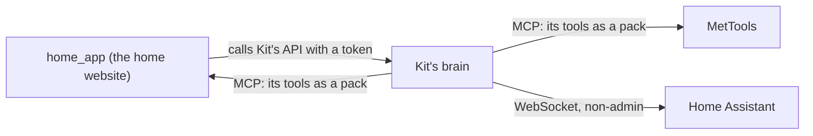

# Other apps

> [!ABSTRACT] In short
> Kit stands on his own. Other apps can **show and configure** him by calling
> his API, and any app with an **MCP server** becomes a **pack of his tools**:
> list one under `apps.servers` and its tools load when a message is about
> it. A tool that changes something asks first. If an app is down he says
> it's out of reach and carries on; he never needs one to run.



## The rule

**Kit never depends on home_app**, or on any other app. Apps that configure
Kit call him; when Kit uses an app's tools it's an extra he can do without.
His settings live in his own data folder and have their own page,
`kit config` and the desk app, so nothing else has to be up for him to be
himself. See [[Settings and Data]].

## Apps as packs

An app joins Kit in three steps:

1. **It runs an MCP server.** The Model Context Protocol is a small, shared
   way for an app to list its tools and run them. Kit is the client. It
   reaches the server over **HTTP** (the server's address, for an app on
   another machine) or starts it as a **program** on the same box and talks
   to it line by line.
2. **It gets a line in Kit's settings**, under `apps.servers.<name>`: its
   `url` or `command`, the name of its token file in the secrets folder
   (`token_secret`), and the `words` and `questions` that should load it,
   since a server can't say those. See [[Settings Reference#apps]].
3. **Optionally, a `contents` tool.** Once a day Kit asks for the app's saved
   work as rows (`{"kind", "ref", "text", ...}`) and keeps them in his memory
   as the `app:<name>` source. So "my last pump calc" is found by meaning,
   and the [[Register of Things]] can link to it.

Then restart Kit. `kit check` gets a line per app: connected, and how many
tools it has.

### What becomes of its tools

Each tool the server lists becomes one of Kit's, named after the app
(`mettools_run_calculation`), with the server's own description and
arguments. What it does to your world comes from the tool's own labels
(its **annotations**):

| The server says | Kit treats it as | Asks first? |
|---|---|---|
| Read-only | a look | No |
| Not destructive | an action | No |
| Destructive, or says nothing | a change | Yes, every time |
| Named in the app's `confirm` | as above | Yes |

A tool that says nothing about itself asks, because by the protocol's own
rules it may change things. The app adds the labels when it's ready.

Two tools of Kit's own join every app's pack:

- `<app>_status` says whether the app can be reached and what he can do in
  it. While it's down this is the only one offered, so he says "MetTools is
  out of reach right now" instead of guessing.
- `<app>_find` searches the app's saved work in his memory, once there is
  some.

A text answer comes back as it is (cut at about 8,000 characters). A
picture or a file is described ("an image, image/png, 120 kB"), never passed
on. A **private** app's answers reach a cloud model only as the local
model's short summary, like a private folder's. See [[Privacy]].

### When an app goes away

He lists each app's tools again every `apps.relist_minutes` (60), and at
once when the server says they changed. If an app stops answering, its tools
drop out and he tries again: after 5 seconds, then 10, 20 and so on, up to
every five minutes. Nothing else about him changes.

### From the phone

On the phone he tells you things rather than opening them. If you ask him to
open something, it opens on the PC, and he says it happened there.

## home_app

The home website (Django, on the NAS) has a **Kit section**:

| Page | What's on it |
|---|---|
| Health | His face, how he's feeling and his needs, a chat box, and what the cloud has cost this month |
| Settings | All of Kit's settings, drawn from his settings schema, so new settings show up by themselves |
| Memories | What he remembers: search, pin, edit and forget |

![[home-app-panel.jpg|420]]

- home_app talks to Kit **from its server**, with Kit's token from
  `kit token`. The token never reaches the browser.
- Chat from home_app uses the `home` channel, so Kit knows where you're
  talking from. See [[Brain#Where you're talking from]].
- His face is drawn from the same character sheet as the desk. For Kit 3D,
  home_app passes the brain's face page through, so it's the same live 3D
  face. See [[Face]].
- The Kit pages are for people given `view_kit` or `control_kit` in
  home_app, since memories are private.
- home_app also has an MCP server (trips, vehicles, bills, fuel), which Kit
  uses as the `home_app` pack, marked private. Its labels and `contents`
  rows come in part F3.

## MetTools

Dan's engineering calculators. Its MCP server runs calculations, saves them
and reads saved work, and Kit uses it as the `mettools` pack. Full control
(saved work as `contents` rows, opening a calculation, the most-used tools
run headless and live on their pages) comes in part F2.

## Home Assistant

Kit connects to Home Assistant over its WebSocket API as his own non-admin
user, to see and switch what you expose to Assist, with locks, alarms and
the garage confirmed first. If it's down he says the house is out of reach
and carries on. See [[The House]].

## Try it

```
kit config set apps.servers.mettools.url http://192.168.1.50:8001/mcp
kit config set apps.servers.mettools.token_secret mettools_token
kit config set apps.servers.mettools.words '["pump", "slurry", "calc", "MetTools"]'
kit check
```

Restart Kit, then ask him: "what's in MetTools?"

## Go deeper
- [[API]]: the endpoints home_app uses.
- [[Tools and Packs]]: packs, offering and asking first.
- [[Stage 4 - Tools]]: part F1's setup and test checklist.
- [[Privacy]]: tokens, and what stays local.
- [[The House]]: Home Assistant, the house pack and what he notices.

> [!under-the-hood]- Under the hood: the code
> - `src/kit/mcp_client.py`: the small MCP client, over HTTP or a program's
>   input and output.
> - `src/kit/tools/mcp.py`: `App` (the connection, listing, reconnecting)
>   and its pack, and `write_contents` for the saved work.
> - `src/kit/checks.py`: the `app:` lines of `kit check`.
> - `src/kit/routes/`: the API other apps call, one file per part of Kit.
> - `src/kit/channels.py`: the `home` and `phone` channels.
> - `src/kit/settings.py`, `src/kit/settings_store.py`: the settings, their schema, and changes with undo.
