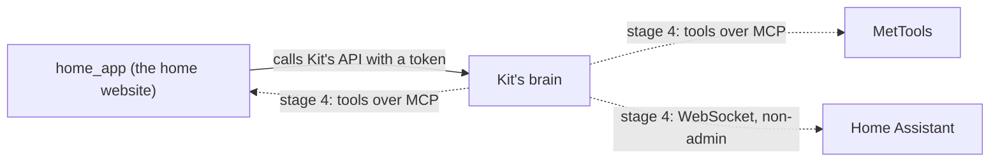

# Other apps

> [!ABSTRACT] In short
> Kit stands on his own. Other apps can **show and configure** him by calling
> his API, and later Kit will **use them as tools**, but he never needs them
> to run. If one is down, Kit carries on and says so if he needed it.

## The rule

**Kit never depends on home_app**, or on any other app. Apps that configure
Kit call him; Kit never calls them to work. His settings live in his own data
folder and have their own page, `kit config` and the desk app, so nothing
else has to be up for him to be himself. See [[Settings and Data]].

## home_app

The home website (Django, on the NAS) has a **Kit section**:

| Page | What's on it |
|---|---|
| Health | His face, how he's feeling and his needs, a chat box, and what the cloud has cost this month |
| Settings | All of Kit's settings, drawn from his settings schema, so new settings show up by themselves |
| Memories | What he remembers: search, pin, edit and forget |

![[home-app-panel.jpg|420]]

- home_app talks to Kit **from its server**, with Kit's token from
  `kit token`. The token never reaches the browser.
- Chat from home_app uses the `home` channel, so Kit knows where you're
  talking from. See [[Brain#Where you're talking from]].
- His face is drawn from the same character sheet as the desk. For Kit 3D,
  home_app passes the brain's face page through, so it's the same live 3D
  face. See [[Face]].
- The Kit pages are for people given `view_kit` or `control_kit` in
  home_app, since memories are private.

## MetTools

Dan's engineering calculators. The plan, for stage 4, is that Kit can read
saved work and run a calculation when asked, and the app can ask Kit for help
on any page. Each app owns a small token API and an **MCP server**; Kit
connects to them as a client, so any model can use the tools, and if a
server is unreachable its tools simply drop out.

## Home Assistant

Also stage 4: Kit connects to Home Assistant over its WebSocket API as a
non-admin user, to see and switch things in the house, with anything that
matters confirmed first.

## Go deeper
- [[API]]: the endpoints home_app uses.
- [[Roadmap]]: stage 4, tools.
- [[Privacy]]: tokens, and what stays local.

> [!under-the-hood]- Under the hood: the code
> - `src/kit/server.py`: the API other apps call.
> - `src/kit/channels.py`: the `home` channel.
> - `src/kit/settings.py`, `src/kit/settings_store.py`: the settings, their schema, and changes with undo.
