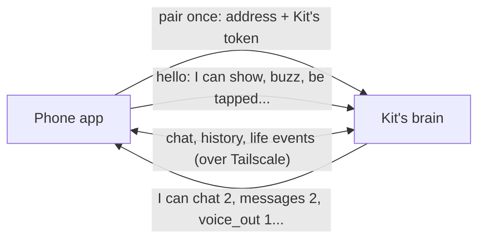

# Phone app

> [!ABSTRACT] In short
> Kit for Android puts his face at the top of your phone and the whole
> conversation under it, and he knows you're out with your phone. The phone is
> one more of his [[Bodies]], the one that leaves the house. The brain stays on
> the server and the phone reaches it over Tailscale. You pair it by typing
> Kit's address and token, and it updates itself from GitHub.

## What it does

- **Chat, with Kit on top.** The same conversation as the desk and home_app,
  as far back as you scroll, with his face in a header that acts out every
  reply. What you said at the desk is marked "at the desk". Scroll back and his
  face shrinks into the top bar.
- **Knows he's on the phone.** Messages go in on the `phone` channel, so he
  keeps it short for a small screen and doesn't assume your PC is in front of
  you. See [[Brain#Where you're talking from]].
- **Never loses a message.** See [[#Never losing a message]].
- **Grey when he's out of reach,** like the desk, with a banner that says why
  in plain words: Tailscale is off on the phone, or his PC is off.
- **Boop and pat.** Tap his face for a boop, hold it for a pat; the phone
  buzzes.
- **Updates itself** from GitHub, like the desk app.
- **Later:** his pipe-ups as notifications when you're away from the desk,
  Talk mode with his voice, a home-screen widget with his face, sharing things
  to him, and a few senses (home or out, walking, driving), always worked out on
  the phone and sent as words. See [[Roadmap]].

## How it works



### Pairing

No console needed: type Kit's address and token into the app once. Both are
on the desk app's **This PC** page, where **Copy** puts the token on the
clipboard. The app swaps that token for one of its own
(`POST /api/devices/pair`) and keeps only the new one, sealed with a key in
Android's keystore. On the server, `kit pair phone` does the same with a QR code
instead: scan it with the phone's camera and Kit opens, asking to pair.

If the phone is lost, `kit devices forget phone` (or
`DELETE /api/devices/phone` with Kit's token) stops that one token working,
and the desk, home_app and the eyes carry on with the shared token. The brain
keeps only a hash of each device's token. The app's **About this phone** has
**Unpair** too.

### Saying hello

When the app starts it calls `POST /api/bodies/hello` with what it is and
what it can do (`screen`, `haptics`, `touch` for now). The brain answers with
its **features**, each with a version number, the life events it sends, and
which face page to open. The app only uses features the brain offers, so a new
Kit feature lights up in an app that knows it, and an old app on a new brain
keeps working. The same hello works for any body: the desk app, home_app and
the Pod can use it too.

The brain keeps a list of bodies it has heard from (`GET /api/bodies`): when
each was last seen and when Dan last talked through it. That's how a pipe-up
picks one body to say it out loud. The phone doesn't say it has a speaker yet,
so for now it's never picked.

### What a message carries

Besides `text` and `channel`, a chat message can say which `body` it came
through, when it was written (`sent_at`) if it waited to be sent, and whether
it was `spoken`. Each is stored with the message. See [[API#Talking]].

### Never losing a message

Anything typed while Kit is out of reach waits on the phone, marked "waiting to
send", and goes by itself when he's back, even with the app closed. It goes
with the time it was written, so Kit is told it may be old news. The latest
conversation is kept on the phone too, so it's there to read on a train.

### His face on the phone

When Kit's character has a 3D look, the header shows the brain's 3D face page,
the same one the desk shows, so a new look reaches the phone with no update.
Otherwise, and while the 3D face loads, the phone draws Kit 2D itself from the
same character sheet. Menu > **Show his 2D face** keeps him 2D (lighter on the
battery). More in [[Phone App In Depth#His face]].

## Try it

Install and test it with [[Phone Stage 1 - Pocket Kit]]. On the server:

```
kit pair phone
kit devices
kit devices forget phone
```

## Go deeper
- [[Phone App In Depth]]: the code, builds, signing and updates.
- [[Bodies]]: one Kit, many bodies, and where the phone fits.
- [[API#Kit's bodies and paired devices]]: the hello and the bodies list.
- [[Privacy#Tokens and secrets]]: the shared token and device tokens.

> [!under-the-hood]- Under the hood: the code
> - `android/`: the app ([[Phone App In Depth]]).
> - `src/kit/devices.py`: paired devices and their tokens.
> - `src/kit/body_registry.py`: the hello, features and the list of bodies.
> - `src/kit/channels.py`: the channel line, with spoken and written-earlier.
> - `src/kit/server.py`: the routes and the token check.
