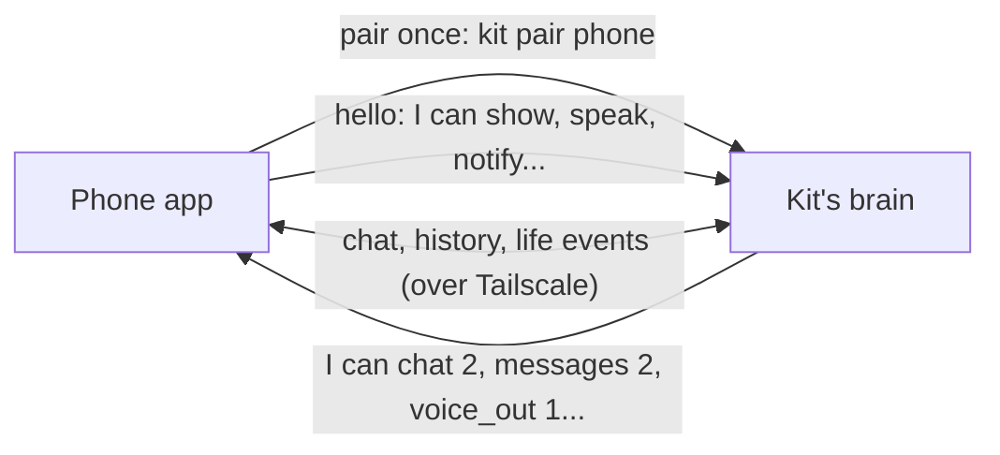

# Phone app

> [!ABSTRACT] In short
> Kit is getting an Android app: his face at the top, the whole conversation,
> his voice, and him knowing you're out with your phone. The phone is one more
> of his [[Bodies]], the one that leaves the house. The brain stays on the
> server and the phone reaches it over Tailscale. Phase 0, the brain's side,
> is built: a phone **pairs** with a token of its own, **says hello** with
> what it can do, and the brain answers with what *it* can do.

## What it will do

- **Chat, with Kit on top.** The same conversation as the desk and home_app,
  with his face in a header that acts out every reply. Messages from the desk
  are marked as from the desk.
- **Know he's on the phone.** Messages come in on the `phone` channel, so he
  keeps it short for a small screen and doesn't assume your PC is in front of
  you. See [[Brain#Where you're talking from]].
- **Never lose a message.** Anything typed while he's out of reach waits on
  the phone and goes later with the time it was written. He's told it may be
  old news.
- **Talk mode.** Said out loud rather than typed, so he answers short and
  natural, in his own voice.
- **Later:** his pipe-ups as notifications when you're away from the desk, a
  home-screen widget with his face, sharing things to him, and a few senses
  (home or out, walking, driving), always worked out on the phone and sent as
  words.

## How it works



### Pairing

`kit pair phone` makes a token just for the phone and shows a QR code holding
Kit's address, the name and the token. The app scans it once. If the phone is
lost, `kit devices forget phone` stops that one token working, and the desk,
home_app and the eyes carry on with the shared token. The brain keeps only a
hash of each device's token.

### Saying hello

When the app starts it calls `POST /api/bodies/hello` with what it is and
what it can do (`screen`, `speaker`, `mic`, `notify`...). The brain answers
with its **features**, each with a version number, the life events it sends,
and which face page to open. The app only uses features the brain offers, so
a new Kit feature lights up in an app that knows it, and an old app on a new
brain keeps working. The same hello works for any body: the desk app, home_app
and the Pod can use it too.

The brain keeps a list of bodies it has heard from (`GET /api/bodies`): when
each was last seen and when Dan last talked through it. That's where choosing
one body to speak a pipe-up will live.

### What a message carries

Besides `text` and `channel`, a chat message can say which `body` it came
through, when it was written (`sent_at`) if it waited to be sent, and whether
it was `spoken`. Each is stored with the message. See [[API#Talking]].

## Try it

```
kit pair phone
kit devices
kit devices forget phone
```

[[Phone Stage 0 - Pairing]] tests all of it with `curl`, before there's an app.

## Go deeper
- [[Bodies]]: one Kit, many bodies, and where the phone fits.
- [[API#Kit's bodies and paired devices]]: the hello and the bodies list.
- [[Privacy#Tokens and secrets]]: the shared token and device tokens.

> [!under-the-hood]- Under the hood: the code
> - `src/kit/devices.py`: paired devices and their tokens.
> - `src/kit/body_registry.py`: the hello, features and the list of bodies.
> - `src/kit/channels.py`: the channel line, with spoken and written-earlier.
> - `src/kit/server.py`: the routes and the token check.
