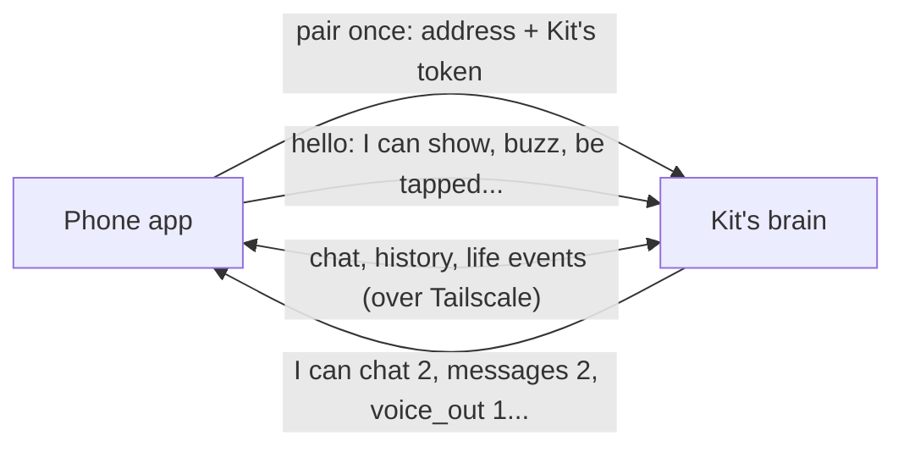
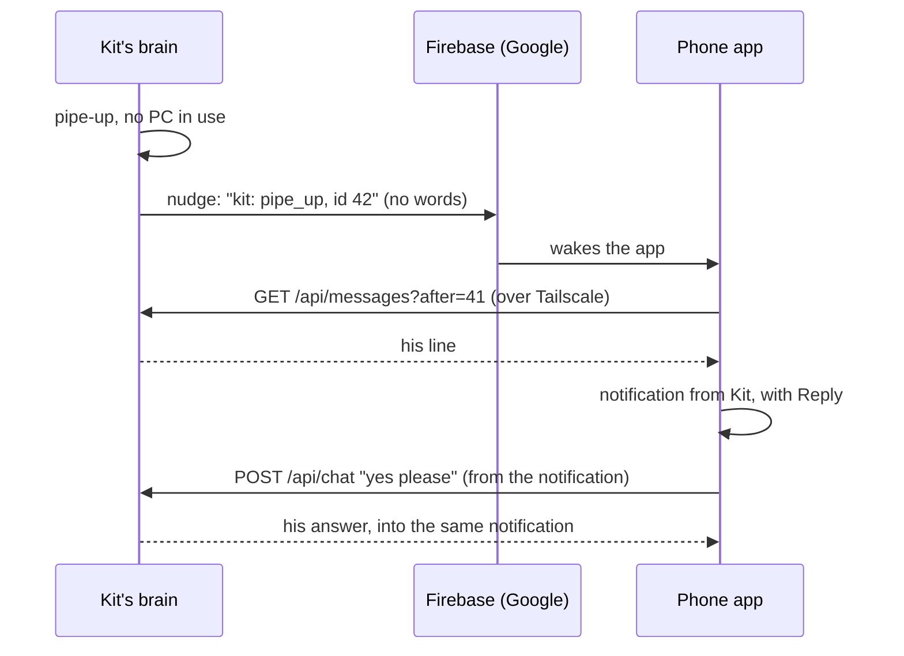

# Phone app

> [!ABSTRACT] In short
> Kit for Android puts his face at the top of your phone and the whole
> conversation under it, and he knows you're out with your phone. When he
> speaks up and the app is closed, it's a notification from him you answer in
> place; he knows whether you're home or out and when the phone's nearly flat;
> and his Kit, Memory and Settings pages are on the phone, with a widget on the
> home screen. The phone is one more of his [[Bodies]], the one that leaves the
> house. The brain stays on the server and the phone reaches it over Tailscale.
> You pair it by typing Kit's address and token, and it updates itself from
> GitHub.

## What it does

- **Chat, with Kit on top.** The same conversation as the desk and home_app,
  as far back as you scroll, with his face in a header that acts out every
  reply. What you said at the desk is marked "at the desk". Scroll back and his
  face shrinks into the top bar.
- **Knows he's on the phone.** Messages go in on the `phone` channel, so he
  keeps it short for a small screen and doesn't assume your PC is in front of
  you. See [[Brain#Where you're talking from]].
- **Never loses a message.** See [[#Never losing a message]].
- **Grey when he's out of reach,** like the desk, with a banner that says why
  in plain words: Tailscale is off on the phone, or his PC is off.
- **Boop and pat.** Tap his face for a boop, hold it for a pat; the phone
  buzzes.
- **He's with you.** With the app closed, a pipe-up is a notification from
  him, with **Reply** (your answer and his come back in the same notification)
  and **Quiet for an hour**. He speaks with one voice: while you're at a PC the
  desk has it, otherwise the phone. See [[#He's with you]].
- **Knows home from out,** and when the phone's nearly flat or charging, from
  what the phone tells him in words. See [[#What the phone tells him]].
- **His pages.** Tabs along the bottom: the chat, Kit himself (how he's
  feeling and why, what he's up to, what's on his mind, his notebook, a quiet
  button), his Memory (search, facts to teach, star or forget, things, days)
  and Settings (the phone's own, then his, drawn from the brain). See
  [[#His pages]].
- **On the home screen.** A widget with his face, how he is and his last line;
  a Quick Settings tile to hush him; **New chat** and **Quiet for an hour**
  shortcuts on the app icon; share text from any app to him; shake the phone
  and he's startled; battery saver keeps his face 2D.
- **Updates itself** from GitHub, like the desk app.
- **Later:** Talk mode with his voice, and more senses (walking, driving),
  always worked out on the phone and sent as words. See [[Roadmap]].

## How it works



### Pairing

No console needed: type Kit's address and token into the app once. Both are
on the desk app's **This PC** page, where **Copy** puts the token on the
clipboard. The app swaps that token for one of its own
(`POST /api/devices/pair`) and keeps only the new one, sealed with a key in
Android's keystore. On the server, `kit pair phone` does the same with a QR code
instead: scan it with the phone's camera and Kit opens, asking to pair.

If the phone is lost, `kit devices forget phone` (or
`DELETE /api/devices/phone` with Kit's token) stops that one token working,
and the desk, home_app and the eyes carry on with the shared token. The brain
keeps only a hash of each device's token. The app's **About this phone** has
**Unpair** too.

### Saying hello

When the app starts it calls `POST /api/bodies/hello` with what it is and
what it can do (`screen`, `haptics`, `touch` for now). The brain answers with
its **features**, each with a version number, the life events it sends, and
which face page to open. The app only uses features the brain offers, so a new
Kit feature lights up in an app that knows it, and an old app on a new brain
keeps working. The same hello works for any body: the desk app, home_app and
the Pod can use it too.

The brain keeps a list of bodies it has heard from (`GET /api/bodies`): when
each was last seen and when Dan last talked through it. That's how a pipe-up
picks one body to say it out loud. The phone doesn't say it has a speaker yet,
so for now it's never picked.

### What a message carries

Besides `text` and `channel`, a chat message can say which `body` it came
through, when it was written (`sent_at`) if it waited to be sent, and whether
it was `spoken`. Each is stored with the message. See [[API#Talking]].

### Never losing a message

Anything typed while Kit is out of reach waits on the phone, marked "waiting to
send", and goes by itself when he's back, even with the app closed. It goes
with the time it was written, so Kit is told it may be old news. The latest
conversation is kept on the phone too, so it's there to read on a train.

### His face on the phone

When Kit's character has a 3D look, the header shows the brain's 3D face page,
the same one the desk shows, so a new look reaches the phone with no update.
Otherwise, and while the 3D face loads, the phone draws Kit 2D itself from the
same character sheet. Menu > **Show his 2D face** keeps him 2D (lighter on the
battery). More in [[Phone App In Depth#His face]].

## He's with you



A phone can't be reached while its app is closed, so the brain sends it a
**nudge** through Firebase Cloud Messaging, the way Android wakes apps. The
nudge is content-free: what it's about (`pipe_up`, or `test`) and the message's
id. Nothing he said leaves the house; the phone fetches his line from the brain
over Tailscale and shows it as a notification from him, in his name, with
**Reply** and **Quiet for an hour**. A reply from the notification is a normal
chat turn: his answer comes back into the notification, and the exchange is in
the chat when you open the app. If he can't be reached, the reply waits in the
[[#Never losing a message|outbox]].

**One voice at a time.** `phone.notify` says when a pipe-up goes to the phone:
`away` (the default) sends it only while no PC is in use, so at the desk the
desk app speaks up and the phone stays quiet; `always` sends every one;
`never` none. `phone.notify_per_hour` caps them. A pipe-up that wouldn't reach
anyone is still kept: the phone shows up to the last three unseen ones when it
next looks in.

**Without Firebase,** or when a nudge gets lost, the phone looks in on him
every half hour anyway and shows what it missed. Setting Firebase up (a free
project, four build variables and one service-account file in his secrets
folder) is in [[Phone Stage 2 - He's With You]]. `kit nudge` sends a test
nudge; `kit devices` shows which devices he can nudge (`notifies`).

## What the phone tells him

The phone reports, in words, whether you're **home or out** and how the
**battery** is (`POST /api/phone/context`), and Kit keeps it the way he keeps
the desk app's report: his pipe-ups, his sense of what's going on and his
answers know it ("Dan's phone says they're out (since 2:05 pm). Their phone's
battery is nearly flat (12%)."). Each has a switch on the phone's Settings
tab, and the Kit tab shows the line he sees.

Home is worked out on the phone with no location permission: you mark the
Wi-Fi you're on as home once, and the phone keeps a scrambled fingerprint of
that network's addresses. On it: home. On another network or mobile data: out.
Kit, Firebase and the brain never see a network name, an address or a
location, only the word. A report goes when the place changes, when the
charger comes or goes, when the battery crosses low, and otherwise every half
hour at most. After twelve hours with no report he says so rather than trust
it. More in [[Inner Life#Piping up, with manners]] and [[Privacy]].

## His pages

Tabs along the bottom of the app:

- **Chat:** as before, with text shared to Kit from any app landing in the
  box.
- **Kit:** the phone's version of the desk app's Kit page ([[Inner Life]]): how
  he's feeling and why, his energy, what he's up to and has done today, what's
  on his mind and means to bring up, his quirks, what this phone tells him, who
  he thinks he is and what he's noticed about you, his journal and moments.
  **Quiet for an hour** and **Let him speak** are here too. Pull down to look
  again.
- **Memory:** search what he remembers the way he does ([[Memory]]); teach him
  a fact with its kind, star one to always keep in mind, forget one; his
  register of things and his day summaries.
- **Settings:** this phone's own (notifications, home and out, the battery, his
  3D face), then his settings, drawn from the brain's settings schema the way
  the desk's and home_app's pages are ([[Settings and Data]]), with **Undo last
  change**. A new setting on the brain shows on the phone without an update.
  Sections of named profiles (models, voice engines) point to the PC.

## Try it

Install and test it with [[Phone Stage 1 - Pocket Kit]] and
[[Phone Stage 2 - He's With You]]. On the server:

```
kit pair phone
kit devices
kit nudge
kit config set phone.notify always
kit devices forget phone
```

## Go deeper
- [[Phone App In Depth]]: the code, nudges, builds, signing and updates.
- [[Bodies]]: one Kit, many bodies, and where the phone fits.
- [[Inner Life]]: the pipe-ups the notifications carry, and what he knows of the moment.
- [[API#Kit's bodies and paired devices]]: the hello and the bodies list.
- [[Privacy#Tokens and secrets]]: the shared token and device tokens.

> [!under-the-hood]- Under the hood: the code
> - `android/`: the app ([[Phone App In Depth]]).
> - `src/kit/devices.py`: paired devices, their tokens and push tokens.
> - `src/kit/push.py`: nudging the phone through Firebase.
> - `src/kit/phone_context.py`: the phone's report, home or out and the battery, as a line for him.
> - `src/kit/body_registry.py`: the hello, features and the list of bodies.
> - `src/kit/channels.py`: the channel line, with spoken and written-earlier.
> - `src/kit/server.py`: the routes and the token check.
