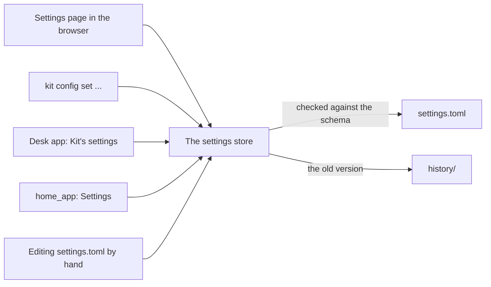

# Settings and data

> [!ABSTRACT] In short
> Everything Kit owns lives in **one data folder**: his settings, his secrets,
> his memory, backups and logs. Nothing is written anywhere else, so moving
> Kit to a new machine is copying that folder. **Settings** are one file you
> can change from four places, every change is checked first and can be
> undone. **Secrets** (API keys, the token) are never in the settings or the
> repo.

## The data folder

| On | Where |
|---|---|
| Linux (the server) | `/var/lib/kit` |
| Windows | `C:\ProgramData\Kit` |
| Anywhere | wherever `KIT_DATA_DIR` points |

```
Kit data folder/
├── config/
│   ├── settings.toml            his settings
│   ├── settings.last-good.toml  the last version that worked
│   └── history/                 every earlier version, for undo
├── secrets/                     API keys and the API token (owner-only)
├── state/
│   ├── memory.db                his memory: messages, facts, register, notebook, spend
│   ├── faces.json               people his eyes know (numbers, never pictures)
│   ├── speech/                  his voice clip and recent speech
│   └── evals/                   eval reports
├── backups/                     a copy of memory.db each day
└── logs/                        kit.log, speech.log
```

`kit paths` prints the folders on any machine. The desk app and the eyes keep
their own few settings on the PC (`%APPDATA%\Kit Desk`, `%APPDATA%\Kit Eyes`).

## Changing settings



- **Every change is checked** against the schema first. A bad value is
  refused with a reason, and a broken hand edit is reported while Kit keeps
  running on the last good version.
- **Every change can be undone**: `kit config undo`, `kit config history`,
  `kit config restore`, or Undo on the settings page.
- **Changes apply from the next message**. Nothing to restart, apart from the
  brain's own address and port.
- The schema drives the pages, so a new setting shows up on the settings page,
  the desk app and home_app by itself.

Every setting, with its default and what it does, is in
[[Settings Reference]].

## Secrets

API keys and the token other apps use are **never** in `settings.toml` or the
repo, so settings can be shown and shared freely.

| Secret | From |
|---|---|
| Anthropic key | `ANTHROPIC_API_KEY`, or `secrets/anthropic_api_key` |
| OpenAI key | `OPENAI_API_KEY`, or `secrets/openai_api_key` |
| Google key | `GEMINI_API_KEY` or `GOOGLE_API_KEY`, or `secrets/gemini_api_key` |
| Kit's API token | `secrets/api_token`, made on first use; `kit token` shows it |
| Firebase service account (phone nudges) | `KIT_FIREBASE_SERVICE_ACCOUNT` (a path), or `secrets/firebase_service_account.json`. See [[Phone Stage 2 - He's With You]] |

The desk app, the eyes and home_app each keep a copy of the token on their
own machine. See [[Privacy]].

## Moving Kit

Stop Kit, copy the data folder to the new machine, install Kit there, point
`KIT_DATA_DIR` at the folder if it isn't in the usual place, and start it.
Settings, memory, his notebook and the people he knows all come along. The
voice engine's own Python is the one thing to set up again: see
[[Stage 3 - Voice]].

## Go deeper
- [[Settings Reference]]: every setting.
- [[Stage 0 - Server Setup]]: the data folder's permissions, and the service.
- [[Commands#Settings]]: `kit config` in full.

> [!under-the-hood]- Under the hood: the code
> - `src/kit/paths.py`: where everything lives.
> - `src/kit/settings.py`: every setting, its default and description.
> - `src/kit/settings_store.py`: changes, history, undo and the last good copy.
> - `src/kit/credentials.py`: API keys and the token.
> - `src/kit/settings.example.toml`: an example settings file.
