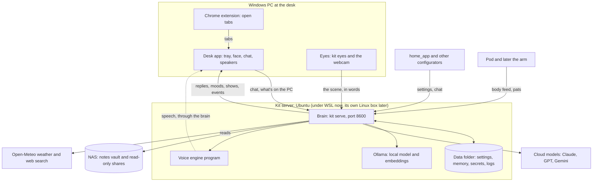

# The big picture

> [!ABSTRACT] In short
> One **brain** on the server does all the thinking, remembering and feeling.
> Everything else is a **body** or a **sense** that connects out to it: the
> desk app shows his face and chat, the eyes tell him who's there, the voice
> engine gives him a voice, the Pod moves. Everything Kit owns lives in one
> **data folder**. He thinks with a **local model** on the GPU and asks
> **cloud models** for real work.

## The parts

| Part | Where it runs | What it does | Read more |
|---|---|---|---|
| **Brain** | The server | The conversation loop, memory, inner life, the web pages and the API | [[Brain]] |
| **Data folder** | The server | Everything Kit owns: settings, secrets, memory, logs. Moving Kit is copying it | [[Settings and Data]] |
| **Local model** | The server's GPU, through Ollama | Small, fast, free: stands in, keeps things private, finds memories by meaning | [[Models and Routing]] |
| **Cloud models** | Anthropic, OpenAI or Google | Real questions, web search, the nightly reflection, within a monthly budget | [[Models and Routing]] |
| **Desk app** | The Windows PC | His face on the desktop, the chat, Kit's window, what's on the PC, his voice through the speakers | [[Desk App]] |
| **Eyes** | Whichever PC has the camera | Watches the webcam and tells the brain who's there and what they're doing, in words, never pictures | [[Eyes]] |
| **Voice engine** | The server's GPU | Turns his words into speech, one sentence at a time | [[Voice]] |
| **Bodies** | The desk app now, the Pod and the arm later | Act out what the brain decides | [[Bodies]] |
| **Configurators** | home_app, the settings page, `kit config` | Change Kit's settings through his API. Kit never calls them | [[Other Apps]] |

## The rules that shape everything

These come from the repo's `CLAUDE.md` and hold for every change:

1. **The brain decides, bodies act.** Moods, sleeping, piping up and what he
   says are decided once, in the brain. The desk app, home_app and the Pod
   all act out the same decisions, so they always agree. A body only adds
   reflexes, like blinking.
2. **Everything connects out to the brain.** The desk app and the eyes call
   the brain; nothing on the desk PC listens on the network. So no firewall
   rules, and a body can be anywhere on the network or tailnet.
3. **One data folder.** Kit's state lives only in his data folder. Nothing is
   written anywhere else, so moving Kit to a new machine is a folder copy.
4. **Kit never depends on home_app.** Configurators call Kit; Kit never calls
   them. He runs fine with none of them.
5. **Cross-platform.** The server runs on Linux now and must still run on
   Windows. Windows-only code lives only in the desk app.
6. **Secrets stay secret.** API keys live in the data folder's secrets
   directory, never in settings or the repo.
7. **One index for everything he can recall.** Facts, days, conversations,
   notes, his own thoughts and what his eyes saw all go in one searchable
   index, so recall and the memory page cover them all. See [[Memory]].

## How the brain keeps time

Besides answering messages, the brain runs a few loops in the background
(`src/kit/server.py`):

- **Heartbeat** (every half minute or so): his drives move, he may fidget,
  pipe up or have a thought. See [[Inner Life]].
- **Upkeep**: after midnight he summarises the day, reflects on it, tidies
  memory and the notebook, fills in missing meaning vectors and backs memory
  up. See [[Memory]] and [[Inner Life]].
- **Notes**: every few minutes he brings the index up to date with the notes
  vault. See [[Notes on the NAS]].
- **Voice**: loads the voice engine when speech is on, and stops it (freeing
  the GPU) when it's off. See [[Voice]].

## Go deeper
- [[Life of a Message]] follows one message through all of this.
- [[Code Map]] lists every module and the note that explains it.
- [[API]] lists the routes the bodies and pages use.
