# The House

> [!ABSTRACT] In short
> Kit talks to **Home Assistant** over its WebSocket API as **his own
> non-admin user**, with a long-lived token kept in the secrets folder. He
> sees **only what you expose to Assist**, so you choose exactly what he can
> touch. Ask in plain words ("turn the study lamp off", "is the aircon on?",
> "who's home?") and the `house` pack loads. **Locks and alarms always ask
> first, the garage asks every time, the aircon asks once a day**, and
> unlocking from the phone is refused unless you turn it on. He also
> **notices** things: someone getting home, a door opening after dark, a
> light left on for hours.

## What it does

- "Turn the study lamp off", "lounge lights to 30 percent", "make the lamp
  blue": switched straight away, and he says so.
- "Is the aircon on?", "how warm is it inside?": he reads the state, with
  the temperature and what it's doing.
- "Set the heater to 21": the first time each day he checks ("set the
  heater to 21?"); after your yes, not again that day.
- "Close the blinds" just happens. "Open the garage" asks every time.
- "Lock the front door" always asks first. "Unlock the front door" from the
  phone is refused: he says it has to be done at home.
- "Movie scene please" turns on the scene.
- "Who's home?" lists the people Home Assistant tracks, home or away.
- "Is the shed heater on?", with the shed in the [[Register of Things]]
  linked to `switch.shed_heater`, goes straight to it.
- With Home Assistant down, he says the house is out of reach, and nothing
  else about him changes.

## How it works

```mermaid
flowchart LR
    You["'Turn the study lamp off'"] --> Pack["house pack loads<br/>(words, or a register thing<br/>linked to home_assistant)"]
    Pack --> Find["House.find: name, room,<br/>kind, register link"]
    Find --> Ask{"Asks first?"}
    Ask -- "lock, alarm, garage,<br/>aircon (once a day)" --> Yes["Waits for your yes"]
    Ask -- "no" --> Call["call_service over<br/>the WebSocket"]
    Yes --> Call
    Call --> HA["Home Assistant<br/>(Kit's own non-admin user)"]
    HA -- "state_changed" --> Watch["Watcher: got home,<br/>door after dark, left on"]
    Watch --> Life["Inner life: curious,<br/>may mention it"]
```



### Only what you expose

Kit keeps only the entities Home Assistant **exposes to Assist** (Settings,
Voice assistants, Expose). Everything else doesn't exist as far as he knows:
he can't see it, find it or switch it. To give him a light, expose it; to
take it away, un-expose it. He reads the whole list again every
`house.refresh_minutes` (60) and after each reconnect, and `state_changed`
events keep the states current in between.

Rooms come from Home Assistant's **areas**: an entity's own area, or its
device's area if it has none.

### Finding the thing you mean

`House.find` scores every exposed thing against your words:

| Match | Example |
|---|---|
| Its id | `light.study_lamp` |
| Its name | "study lamp" |
| Its room | "the lounge lights" (room and kind) |
| Its kind | "lamp" or "lights" means a light; "aircon", "heater" a climate unit; "garage", "blinds" a cover |
| A register link | the Shed, linked to `switch.shed_heater` or `area:Shed` |

The best match wins. When several fit equally ("the lights" with three
lights on), he asks which one rather than guessing. A word for a kind never
matches a different kind in the same room: "the lounge lights" doesn't
close the lounge blinds.

### Asking first

| Thing | Asks? |
|---|---|
| Locks and alarms (`house_secure`) | Always |
| The garage door | Every time |
| Other blinds and curtains | No |
| Aircon and heating | Once a day per unit (`house.climate_confirm_daily`) |
| Lights, switches, fans, scenes | No |
| Any kind in `house.confirm` | Always |

`house.confirm` starts as locks and alarms; add `cover` to make every blind
ask, or `light` for the lights. A yes works like any other tool's: see
[[Tools and Packs#Asking first]].

**From the phone**, unlocking a lock or disarming the alarm is refused, even
with a yes, unless `house.secure_from_phone` is on. Locking and arming still
work, after a yes.

### Noticing

Changes to the things in `house.notice` (doors, the garage and people, by
default) feed his [[Inner Life]]:

- a person getting home or leaving;
- a watched door or the garage opening **after dark** (5 pm to 6 am);
- a light or switch on for longer than `house.long_on_minutes` (4 hours),
  once each time.

Each one makes him curious about it, and he may mention it when he next
pipes up ("the garage just opened, after dark: was that you?"). He never
acts on what he notices.

### In his memory

Once a day the exposed things and rooms go into his memory as the `house`
source: "Study lamp, a light in the Study (Home Assistant
`light.study_lamp`)" and "The Study, a room in the house. In it: ...". So
"what's in the study?" and the memory page find them too. See
[[Memory In Depth]].

## The tools

| Tool | What it does |
|---|---|
| `house_find` | Things by name, room or kind, with their state. Empty: how many and which rooms |
| `house_state` | One thing's state and the attributes worth telling (brightness, temperature, position, battery) |
| `house_set` | A light, switch, fan or script on or off, with brightness and colour for lights |
| `house_climate` | A temperature, a mode, or both |
| `house_scene` | Turns on a scene |
| `house_cover` | Opens, closes or stops a blind or the garage |
| `house_secure` | Locks or unlocks, arms or disarms. Always asks |
| `who_is_home` | The people Home Assistant tracks, home or away |

Only `house_find` is offered while Home Assistant is out of reach, so he can
say so.

## Setting it up

1. In Home Assistant, make a user for Kit (Settings, People, Users) and
   leave **Administrator** off.
2. Log in as that user, open its profile, Security, and make a
   **long-lived access token**.
3. Put the token in Kit's secrets folder as `home_assistant_token` (or the
   `KIT_HOME_ASSISTANT_TOKEN` environment variable).
4. Expose what he may touch: Settings, Voice assistants, Expose.
5. Set `house.url` (for example `ws://192.168.1.60:8123/api/websocket`)
   and turn on `house.enabled`, then restart Kit.

`kit check` then says "reachable as Kit (not an admin), 23 things exposed
to Assist", or warns if the user is an admin or nothing is exposed.

## Try it

```
kit check
kit house list
kit house list Study
kit house state "study lamp"
kit house set "study lamp" off
kit eval tools --pack house
```

Then ask him: "Is the aircon on?"

## Go deeper
- [[Stage 4 - Tools]]: part D1's setup and test checklist.
- [[Tools and Packs]]: packs, offering and asking first.
- [[Privacy]]: what goes to the cloud model about the house.
- [[Register of Things]]: linking a thing to an entity or area.

> [!under-the-hood]- Under the hood: the code
> - `src/kit/house/client.py`: `HomeAssistant`, the WebSocket client: auth,
>   reconnecting with backoff, replies by id, `state_changed` events, and
>   the reads and service calls.
> - `src/kit/house/model.py`: `House`, `Entity`, `Area`: the exposed things,
>   refreshed and kept current, and `find`.
> - `src/kit/house/noticing.py`: `Watcher`, what he notices.
> - `src/kit/house/contents.py`: the `house` source in his memory.
> - `src/kit/tools/house.py`: the house pack and its eight tools.
> - `src/kit/server.py`: the house loop (refresh, contents, the watcher).
> - `src/kit/checks.py`: the `house` line of `kit check`.
> - Settings: [[Settings Reference#house]].
