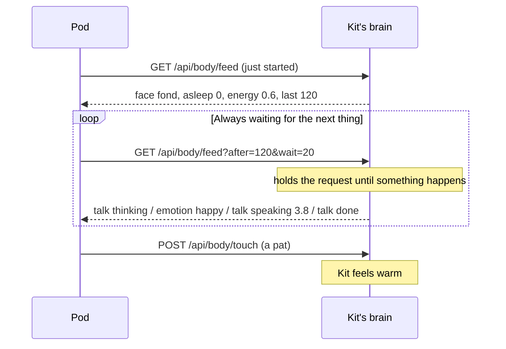

# The Pod

> [!ABSTRACT] In short
> The Pod is Kit's first robot body: about 13 cm of printed plastic with
> **his face on a 1.5" screen**, a **head that turns and nods** on two hobby
> servos, a **pat sensor** on top, and an **ESP32** inside that talks to the
> brain over Wi-Fi. The brain still does all the thinking. The Pod reads a
> plain-text **body feed** (his mood, his reply's emotion, when he's talking,
> sleeping, or looking at someone) and acts it out. Pat his head and Kit feels
> it. With no brain to talk to, he potters about on his own.

![[pod-v2-hero.jpg|360]]

## What he's like on the desk

| | |
|---|---|
| **His face** | Kit 2D, the 3D face drawn flat, with all 20 moods and 19 gestures, drawn by the ESP32 itself |
| **A calm neck** | The face is as lively as on the desk; the head only moves when he pays attention: a glance round the room, something catching his eye, a real gesture, or his mood's posture |
| **Pats** | One pat: a happy wiggle. Three quick ones: he laughs. Asleep: a pat wakes him, fond |
| **Following the brain** | His resting face is Kit's mood; while Kit answers he looks thoughtful, shows the reply's emotion and moves his mouth as the words are said |
| **Sleep** | He sleeps and wakes when Kit does: head down, eyes shut |
| **Looking at you** | With Kit's [[Eyes]] running, someone arriving catches his eye and he turns to them; when Kit greets someone by name, the Pod faces them |
| **On his own** | No brain? He blinks, looks round, changes mood now and then and dozes after a few minutes alone |

![[pod-turnaround.jpg]]

*Front, side and back. The orange rings are his ears; the dimples on the side
are where a speaker will go.*

![[pod-nod.jpg|560]]

*His head nods up and down on the tilt servo inside it, and the whole neck
turns on the servo in the body.*

## His face on the Pod

The Pod draws Kit 2D's `kit2d_screen` look from the same character sheet the
desk and home_app use, so a new mood or a retuned gesture reaches the Pod by
rebuilding its face table. See [[Face]].

> [!example]- Every mood on the Pod's screen
> ![[pod-screen-moods.png]]

> [!example]- Every gesture on the Pod's screen
> ![[pod-screen-gestures.png]]

## How he talks to the brain

- **One plain line per thing** ("emotion happy", "look -0.40 0.12"), so a
  small board reads it without a JSON library. The full list of lines is in
  [[Pod In Depth#The body feed]].
- **The Pod asks, the brain answers**: the Pod keeps one request open and the
  brain answers the moment something happens, so there's no lag and nothing
  has to reach in to the Pod.
- **The network and the face never wait on each other**: one core of the
  ESP32 talks to the brain, the other draws the face 60 times a second.
- **Lost the brain?** After a minute without hearing from Kit, the Pod runs on
  its own until the brain is back.

> [!NOTE] Where it's up to
> The Pod's program, its printed parts and the network helper are in this
> repo under `pod/`. The brain's side, the body feed and pats, is pull request
> #36. Next: a speaker and microphone in the Pod, so Kit can talk and listen
> in the room, one voice at a time.

## Go deeper
- [[Pod In Depth]]: the parts, the wiring, the program, the feed line by line, the calm neck's rules.
- [[Building the Pod]]: print, assemble, wire, upload and link him to Kit, with a picture for every step.
- [[Bodies]]: the Pod as one of Kit's bodies.

> [!under-the-hood]- Under the hood: the code
> - `pod/firmware/kit_pod_face/kit_pod_face.ino`: the Pod's whole program.
> - `pod/firmware/kit_pod_face/make_sheet.py`: turns Kit 2D's character sheet into the Pod's face table.
> - `pod/cad/kit_pod_v2.py`: every printed part, as code.
> - `pod/network/kit-port-forward.ps1`: lets the Pod reach Kit inside WSL.
> - `src/kit/face/characters/kit2d.json`: the face it draws.
