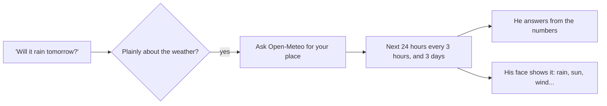

# Time and weather

> [!ABSTRACT] In short
> Kit always knows **the time and date where you are** (`persona.timezone`),
> and every reply is written with it in mind. He understands times the way
> people say them ("Thursday arvo", "after my 2 pm", "the weekend") so he can
> follow what's coming up in your life. For the **weather** he asks a real
> forecast service, Open-Meteo, and answers from its numbers, never from a
> guess, and his face shows it.

## The clock

- The brain reads the clock in your time zone, and every prompt carries
  the day, date and time, so "is it too late to ring Mum?" gets a sensible
  answer.
- How long it's been matters as much: how long since you last talked, how
  long you were away, how long you've been at the desk. These drive his
  hellos, his sleep and his nudges. See [[Companion]] and [[Inner Life]].
- **Quiet hours** (`life.quiet_from` to `life.quiet_until`) stop him piping
  up at night, and `life.bedtime` is when he starts nudging you toward bed.

## Times in plain words

When you mention something with a day or time ("dentist Thursday arvo",
"check in after my 2 pm", "tonight", "next week"), Kit works out when that is
and writes it in his notebook as a **thread**. He asks how it went once it's
over, once, and brings up what you asked him to at the right moment.

| You say | He takes it as |
|---|---|
| this morning | 7 to 11:30 am |
| lunchtime | 11:30 am to 1:30 pm |
| arvo, afternoon | 1:30 to 5 pm |
| evening | 5 to 9 pm |
| tonight | 7 to 11 pm |

## The shape of the week

With `life.week_thoughts` on, Kit notices the week the way you do: a thought
on Monday, Friday and Saturday mornings, and on public holidays (WA's,
worked out for any year with no network). On Mondays he asks how the weekend
went. See [[Companion#He follows your life]].

## The weather

![[kit3d-weather.png|480]]

*Kit 3D showing the weather: the temperature where his eyes were, and the sky
playing around him.*

- **Open-Meteo** is free and needs no key, and in Australia it blends the
  Bureau of Meteorology's own models with others. Web search is poor at
  forecasts (pages go stale, and some sites block automated reading), so he
  doesn't use it for this.
- **Where**: `persona.location` ("city, state", for example Richmond, NSW) and
  `persona.country`.
- A follow-up like "and tomorrow?" soon after counts as a weather question
  too.
- Weather questions are answered by the local model when routing allows,
  since the numbers do the work. See [[Models and Routing]].
- **His face shows it**: rain, a storm, sun, wind, fog or a scorcher
  (`face.hot_c`), with the temperature where his eyes were. See
  [[Face#Shows for the time, date and weather]].
- **For fun**: a morning weather bet (you each guess the top temperature),
  and watching the weather while you're out. See [[Companion]].

## Go deeper
- [[Companion]]: threads, hellos, nudges and games.
- [[Face In Depth]]: how each show is drawn.

> [!under-the-hood]- Under the hood: the code
> - `src/kit/weather.py`: the forecast from Open-Meteo.
> - `src/kit/when.py`: "Thursday arvo" and friends.
> - `src/kit/holidays.py`: the shape of the week and public holidays.
> - `src/kit/shows.py`: the time, date and weather shows on his face.
> - `src/kit/daily.py`: the daily nudges and Monday's question.
