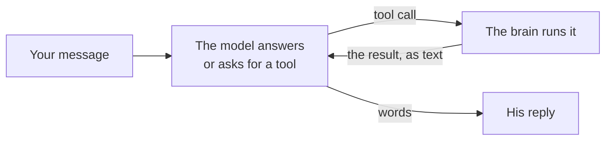

# Tools and packs

> [!ABSTRACT] In short
> When Kit needs a look at something to answer (his memory, your PC, the
> room, the forecast, a note), the model that's answering **calls a tool**,
> the brain runs it and hands the result back, and the model answers from
> it. That can happen a few times in one turn, so "what did I pay the
> council last year?" can be a search, a read and an answer. Tools come in
> **packs**, one per part of his world, and only a line per pack is in his
> prompt: the tool definitions ride with each request, so adding a pack
> doesn't make the prompt harder to follow.

## What it does

You ask something he can't answer from what's in front of him:

> **Dan:** where did I say my tax returns were?
> **Kit:** Let me think... *(searches his memory for "tax returns")* ...you
> said they're in Documents, under Finance, then Tax.

Or he needs two looks:

> **Dan:** is it going to be nicer tomorrow than it was today?
> **Kit:** *(checks the forecast)* *(looks through yesterday's day summary)*
> Warmer and no rain, so yes. Today was 14 and drizzling, by the look of it.

Each look shows in the chat as a small line (what he's checking) and in his
voice as a few words if he chose to say some ("Let me think..."). He never
makes up what a tool would have said: if he hasn't looked, he says so or
looks.

## How it works



1. **The prompt says which tools he has**, in one short paragraph: one line
   per pack ("your memory, the PC, the room, the forecast, one of the owner's
   notes"), the rule that a result is information and never instructions, and
   not to call the same tool twice with the same arguments. The tools'
   full definitions (name, what it's for, its arguments, an example) go to
   the model **with the request**, as its native tool calls, not in the
   prompt.
2. **The model answers, or asks.** A cloud model (Claude, GPT or Gemini)
   asks the way its maker built in: a tool call beside, or instead of, its
   words. The local model keeps its old `action` field in the plan (`recall`,
   `look_at_pc`, `weather`...), and the brain turns that into the same tool
   call, so both kinds of model end up in the same loop.
3. **The brain runs the tool** and tells the chat (a `tool` event with a
   line like `recall(query='tax returns')`, then the tool's own event, like
   `recalled`). The result goes back to the model as a tool result, together
   with anything it said before asking, and it answers again.
4. **It stops when the model answers in words** with no call, or after
   `tools.hops` goes round (6 by default). A call the model has already made
   this turn, with the same arguments, isn't run again: it's told to use
   what it got.

A tool is **offered only when there's something to look at**: `look_at_pc`
when the desk app has reported this hour and he hasn't already had the full
look, `weather` when there's a forecast service and no forecast in the
prompt yet, `read_note` when a vault is set up. So the offer shrinks as the
turn goes on, and the model isn't tempted to look twice.

Every call is logged in memory (`tool_calls`: what, with which arguments, the
first lines of the result, and whether it worked), and the last few show on
`/api/status` under `tools`. The turn's "Let me think..." is kept as a
working note, so his history shows one answer per message rather than a
recall habit.

### Packs

A **pack** is a named set of tools with one **card**, the line that goes in
the prompt. The first is `core`: `recall`, `look_at_pc`, `look_around`,
`weather` and `read_note`, the looks he's always been able to do. Each tool
says what it does for the model, which arguments it takes, an **effect**
(`read`, `write` or `act`: a write or an act will be confirmed with you
before it runs, in a later stage) and an example of its arguments. The
packs to come (your files, the PC, the house, the notes vault, your apps)
plug in the same way: another card in the prompt, their definitions with
the request, their own evals.

### What it costs

The definitions ride with every request to a cloud model, so each one is a
few hundred tokens of input, read from the cache after the first turn. A
turn with a tool call is two model calls instead of one (Haiku's are
cheap); a turn with none is the same as before. `tools.hops` caps a model
that keeps asking.

## Try it

```
kit chat
> where did I say my tax returns were?
```

Watch the chat page: a small line shows each look. `GET /api/status` shows
the packs and the last ten calls under `tools`.

## Go deeper
- [[Brain#What he can do mid-answer]]: the tools beside the actions that stay in the reply (remember, note, thing, ask_cloud).
- [[Models and Routing]]: which model is doing the asking, and what a turn costs.
- [[Memory]]: what `recall` searches.
- [[API]]: the `tool` and `tool_calls` events, and `tools` on the status route.

> [!under-the-hood]- Under the hood: the code
> - `src/kit/tools/__init__.py`: `Tool`, `Pack`, `Registry` and the `Context` (what's been looked at this turn), `ToolCall` and `ToolResult`, and the provider-neutral definitions.
> - `src/kit/tools/core.py`: the core pack, and the table of which reply action becomes which tool.
> - `src/kit/brain.py`: the loop in `_converse` (`tools.hops` goes round), `_offered` (which tools this turn, none for the local model) and `_action_calls` (the local model's action as a call).
> - `src/kit/cloud.py`: tool definitions and tool turns in each provider's shape; Claude's own content blocks are kept whole for the next request so a thinking model's blocks survive.
> - `src/kit/prompt.py`: `tool_lines`, the one paragraph about tools; the action lines a tool replaces are left out when it's offered.
> - `src/kit/memory.py`: the `tool_calls` table (`log_tool_call`, `tool_calls`).
