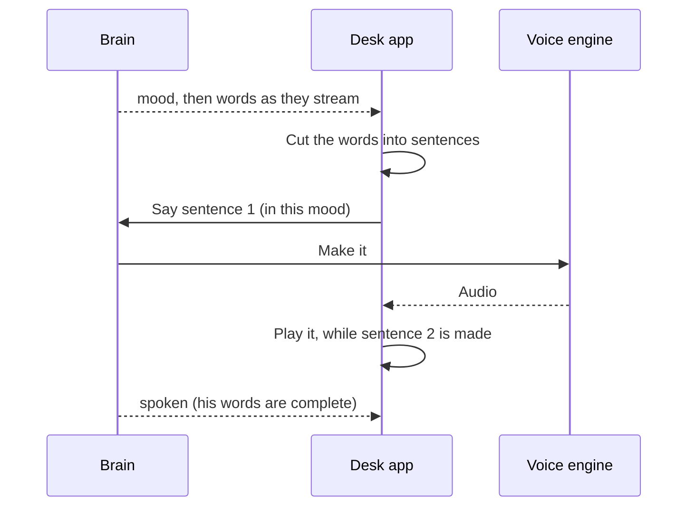

# Voice

> [!ABSTRACT] In short
> Kit speaks his replies through the desk PC's speakers in a voice of his own.
> The **voice engine** runs on the server's GPU as its own small program, and
> can be swapped (Chatterbox Turbo, Chatterbox, Kokoro, Piper). He speaks
> **sentence by sentence** as the brain writes, so he starts talking a few
> words in, not after the whole reply, and a cloud answer as soon as its
> first words arrive. His **mood** colours how he sounds, a joke can get a
> **chuckle** in the right place, and his face moves for exactly as long as
> his voice does. He listens too: say his name and he answers out loud, and
> talking over him stops him ([[Hearing]]).

## How a sentence becomes sound



- **The first sentence is cut short** where it can be, at its first comma
  ("Yeah, ...") or before an "and" or "but", because an engine like
  Chatterbox makes a whole piece before any of it plays.
- **One steady sound output** stays open while he talks, so there are no
  gaps and his first word isn't clipped.
- **His words show as he says them**, and his face acts the reply out as his
  voice starts (a Look page option). Each sentence tells the face how long it
  plays, so his mouth stops when the sound does, and each gesture lands as its
  words start.
- **You talking stops him**, straight away, mid-word.
- **Pipe-ups are said out loud too**, unless he's already talking or his
  eyes see nobody there to hear.
- **Cloud answers stream** (`cloud.stream`): Claude's answer is read as it's
  written, so its mood and first words reach his voice within about a second.

## Sounds in his voice

With `speech.sounds` on, a sentence whose gesture comes with a sound gets it
in his voice, right before its words: a laugh is a **chuckle**, a sigh a
**sigh**, a startle or double take a **gasp**. At most one every other
sentence, since each adds about half a second and they're hit or miss. Only
Chatterbox Turbo makes them; other engines quietly leave them out, and the
words on screen never show them.

## A backup voice

Set `speech.fallback` (say to `kokoro`) and if his usual engine can't start
or runs out of graphics card memory, he switches to it and carries on talking.
He stays on it until his speech settings change. `GET /api/speech` shows which
one he's `using` and why. `kit speech bench` ends each engine's line with
whether it fits the graphics card: at most about 7.5 of 8 GB used at the peak,
measured with everything else Kit keeps on the card.

## Faster on a graphics card

Chatterbox Turbo makes speech in two halves. A language model picks his
speech sounds one at a time (25 make a second of speech), then a decoder turns
them into sound. Picking the sounds is about 90% of the work, and on an RTX
2070 Super it only just kept up with real time: Python was handing the card a
few hundred tiny jobs for every sound.

So on a graphics card that step is recorded once as a **CUDA graph** and
replayed with one call per sound (`cuda_graph`, on by default). It's the same
sums, so his voice doesn't change, but it's about 2.4 times faster: 76 to 80
sounds a second instead of 32. A short first sentence is ready in about 0.8 s
instead of 1.6 s, and every sentence after it is made well before the one
before it finishes playing. It holds about 0.3 GB more graphics card memory.

If the graph can't be recorded, Turbo uses Chatterbox's own loop and says why
in `logs/speech.log`. `GET /api/speech` shows `cuda_graph: true` when it's on.

## Engines

| Profile | Engine | Runs on | Mood shows as |
|---|---|---|---|
| `chatterbox-turbo` | Chatterbox Turbo, copies a reference clip | GPU | an opening sound: a sigh, a chuckle; with `speech.sounds`, sounds inside his words too |
| `chatterbox` | Chatterbox, copies a reference clip | GPU | an emotion dial |
| `kokoro` | Kokoro, voice `af_heart` | CPU | speed |
| `piper` | Piper, `en_US-lessac-medium` | CPU | speed |
| `tone` | beeps, one per word | CPU | for testing |

Each engine runs as its own program with whichever Python has it installed,
since some need clashing libraries. Switching engines stops the old one,
which frees the GPU memory it held. Chatterbox copies whatever voice is in its
reference clip (`state/speech/kit_voice.wav` in the data folder), so changing
his voice is changing the clip.

## Try it

```
kit speech                          # engines, which one's in use, on or off
kit speech use chatterbox-turbo     # switch engine
kit speech on                       # speak replies in the desk app
kit speech say "Hey, how do I sound?" --mood happy
kit speech bench --engines chatterbox-turbo kokoro
```

## Go deeper
- [[Stage 3 - Voice]]: setting up each engine, changing his voice, moving
  Kit to another machine, and the test checklist.
- [[Desk App]]: where the sound comes out.
- [[Companion Stage 4]]: sounds, the backup voice and the bench verdict, with
  the test checklist.

> [!under-the-hood]- Under the hood: the code
> - `src/kit/speech/service.py`: runs the chosen engine and asks it for speech.
> - `src/kit/speech/worker.py`: one engine behind a tiny local web server.
> - `src/kit/speech/turbo.py`: Chatterbox Turbo's token loop as a CUDA graph.
> - `src/kit/speech/sentences.py`: cutting words into speakable pieces.
> - `src/kit/speech/bench.py`: `kit speech bench`.
> - `src/kit/desk/voice.py`: playing it on the desk PC.
