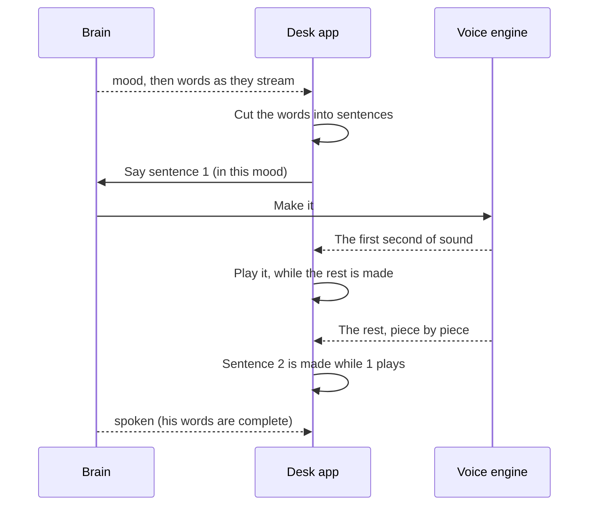

# Voice

> [!ABSTRACT] In short
> Kit speaks his replies through the desk PC's speakers in a voice of his own.
> The **voice engine** runs on the server's GPU as its own small program, and
> can be swapped (Chatterbox Turbo, Chatterbox, Kokoro, Piper). He speaks
> **sentence by sentence** as the brain writes, so he starts talking a few
> words in, not after the whole reply, and a cloud answer as soon as its
> first words arrive. Each sentence comes to the desk **in pieces as it's
> made**, so the first second plays while the rest is still being made. His
> **mood** colours how he sounds, a joke can get a **chuckle** in the right
> place, and his **mouth follows his voice**: it opens on his words and closes
> on his pauses, from the sound itself. Hearing (a microphone, a wake word) is
> the next part of the stage.

## How a sentence becomes sound



- **A sentence comes in pieces as it's made.** Chatterbox Turbo picks his
  speech sounds one at a time (25 a second of speech) and a decoder turns them
  into sound. Rather than waiting for the whole sentence, every 25 sounds (a
  second's worth) go through the decoder together with the last three of the
  window before, whose sound is cross-faded into the join so it doesn't
  click, and that piece is sent on at once: plain 16-bit samples, streamed
  from the engine through the server (`audio/L16`, see [[API]]) to the desk,
  which adds each piece to the sound output as it comes. So a long sentence
  starts playing about a second into its making instead of at the end, and a
  short sentence followed by a long one no longer leaves a hole while the long
  one is made. Engines that make a sentence in one go (Kokoro, Piper) send it as
  one piece through the same path, and `kit speech say` and the bench gather
  the pieces into a whole clip. A sentence of a reply you've interrupted is cut
  short at its next piece.

- **The first sentence is cut short** where it can be, because an engine like
  Chatterbox makes a whole piece before any of it plays: at the first comma
  after at least four words ("Yeah, I had a look at that,"), or before an
  "and" or "but" once a dozen words are in. Never at a one-word clause: a
  "Yeah," on its own got its own falling tune and then a gap, which sounded
  like a stammer.
- **One steady sound output** stays open while he talks, so there are no
  gaps and his first word isn't clipped.
- **The way to the server is open before he speaks**: when you send a message
  the desk app wakes the speakers and makes one cheap call to the brain, and
  connections (desk to brain, brain to voice worker) are kept for a minute
  between sentences, so the first sentence isn't held up opening one. See
  [[Desk App#Connections]].
- **His words show as he says them**, and his face acts the reply out as his
  voice starts (a Look page option). The chat hears each sentence as its first
  piece starts playing and how long it was as its last piece ends, and each
  gesture lands as its words start.
- **His mouth follows his voice.** As the desk hands each bit of sound to the
  speakers it measures how loud it is (smoothed: it opens in about 20 ms and
  closes in about 80 ms) and passes that to his face, which sets how open his
  mouth is: Kit 3D through `kit.setTalk`, Kit 2D's drawn mouth and Glow's
  pulse the same way. So his mouth opens on his words, closes on the pauses
  inside a sentence and stops exactly when the sound does, rather than
  pulsing for a guessed length. See [[Face#The rig, in three layers]].
- **You talking stops him**, straight away, mid-word, and the new reply
  isn't held behind the old one. Every sentence goes to the server with its
  reply's **generation** number (it goes up with each reply begun and each
  interruption). Once the server has seen a higher number, a sentence from a
  lower one is dropped (`410`) instead of made, in Kit's speech service and
  again in the voice worker between clips, so the interrupted reply's leftover
  sentences never take the engine's turn. On the desk, if a sentence of the
  old reply is still being fetched when you interrupt, a fresh fetching
  thread takes the new reply at once and the old answer is thrown away when
  it comes. The aim is the new reply's first sound within half a second.
- **While the engine loads he isn't silent for minutes.** `POST /api/speech/say`
  answers `503` straight away while the engine is still loading (it loads in
  the background), with `Retry-After: 1`. The desk asks again every half
  second, six times, then lets the words show unvoiced and only asks once for
  each of the reply's remaining sentences; the next reply gets its tries again.
  A sentence the server takes more than 30 s over is given up on, so a slow
  server can't hold a reply for minutes either.
- **Pipe-ups are said out loud too**, unless he's already talking or his
  eyes see nobody there to hear.
- **Cloud answers stream** (`cloud.stream`): Claude's answer is read as it's
  written, so its mood and first words reach his voice within about a second.

## Sounds in his voice

With `speech.sounds` on, a sentence whose gesture comes with a sound gets it
in his voice, right before its words: a laugh is a **chuckle**, a sigh a
**sigh**, a startle or double take a **gasp**. At most one every other
sentence, since each adds about half a second and they're hit or miss. Only
Chatterbox Turbo makes them; other engines quietly leave them out, and the
words on screen never show them.

Turbo can also open a reply with a sound for his mood (`mood_tags`): a sigh or
a groan when he's tired, a chuckle or a laugh when he's playful. Each mood has a
few to choose from and one is picked at random, and only six replies in ten
(`mood_tag_chance`) get one at all, so he doesn't start every amused reply with
the very same chuckle. A reply that opens with a sound of its own never gets
the mood's one too.

## A backup voice

Set `speech.fallback` (say to `kokoro`) and if his usual engine can't start
or runs out of graphics card memory, he switches to it and carries on talking.
He stays on it until his speech settings change. `GET /api/speech` shows which
one he's `using` and why. `kit speech bench` ends each engine's line with
whether it fits the graphics card: at most about 7.5 of 8 GB used at the peak,
measured with everything else Kit keeps on the card.

## Faster on a graphics card

Chatterbox Turbo makes speech in two halves. A language model picks his
speech sounds one at a time (25 make a second of speech), then a decoder turns
them into sound. Picking the sounds is about 90% of the work, and on an RTX
2070 Super it only just kept up with real time: Python was handing the card a
few hundred tiny jobs for every sound.

So on a graphics card that step is recorded once as a **CUDA graph** and
replayed with one call per sound (`cuda_graph`, on by default). It's the same
sums, so his voice doesn't change, but it's about 2.4 times faster: 76 to 80
sounds a second instead of 32. A short first sentence is ready in about 0.8 s
instead of 1.6 s, and every sentence after it is made well before the one
before it finishes playing. It holds about 0.3 GB more graphics card memory.

If the graph can't be recorded, Turbo uses Chatterbox's own loop and says why
in `logs/speech.log`. `GET /api/speech` shows `cuda_graph: true` when it's on.

Two more things the graph path does for the first sound:

- **The speaker conditioning is worked out once.** Every line starts with the
  same 375 tokens of his voice clip and a speaker embedding. Their keys and
  values are kept after the first line and copied into the graph's store, so
  each line only runs its own text through the model before the loop starts
  (about 50 to 100 ms less a clip). If the conditioning ever differs, the
  whole prompt is run again and the kept copy replaced.
- **No watermark.** Chatterbox marks every clip with a Perth watermark, 30 to
  80 ms of processor time each, for a public web Kit's voice never reaches.
  Kit's engines hand the sound back as it is (Chatterbox's own loop too, by
  swapping its watermarker for one that does nothing). The `resemble-perth`
  package stays installed, since Chatterbox imports it on start-up.

## Engines

| Profile | Engine | Runs on | Mood shows as |
|---|---|---|---|
| `chatterbox-turbo` | Chatterbox Turbo, copies a reference clip | GPU | an opening sound: a sigh, a chuckle; with `speech.sounds`, sounds inside his words too |
| `chatterbox` | Chatterbox, copies a reference clip | GPU | an emotion dial |
| `kokoro` | Kokoro, voice `af_heart` | CPU | speed |
| `piper` | Piper, `en_US-lessac-medium` | CPU | speed |
| `tone` | beeps, one per word | CPU | for testing |

Each engine runs as its own program with whichever Python has it installed,
since some need clashing libraries. Switching engines stops the old one,
which frees the GPU memory it held. Chatterbox copies whatever voice is in its
reference clip (`state/speech/kit_voice.wav` in the data folder), so changing
his voice is changing the clip.

## Try it

```
kit speech                          # engines, which one's in use, on or off
kit speech use chatterbox-turbo     # switch engine
kit speech on                       # speak replies in the desk app
kit speech say "Hey, how do I sound?" --mood happy
kit speech bench --engines chatterbox-turbo kokoro
```

## Go deeper
- [[Stage 3 - Voice]]: setting up each engine, changing his voice, moving
  Kit to another machine, and the test checklist.
- [[Desk App]]: where the sound comes out.
- [[Companion Stage 4]]: sounds, the backup voice and the bench verdict, with
  the test checklist.

> [!under-the-hood]- Under the hood: the code
> - `src/kit/speech/service.py`: runs the chosen engine and asks it for speech.
> - `src/kit/speech/worker.py`: one engine behind a tiny local web server.
> - `src/kit/speech/turbo.py`: Chatterbox Turbo's token loop as a CUDA graph, and
>   the sound decoded a window at a time.
> - `src/kit/speech/sentences.py`: cutting words into speakable pieces.
> - `src/kit/speech/bench.py`: `kit speech bench`.
> - `src/kit/desk/voice.py`: playing it on the desk PC.
