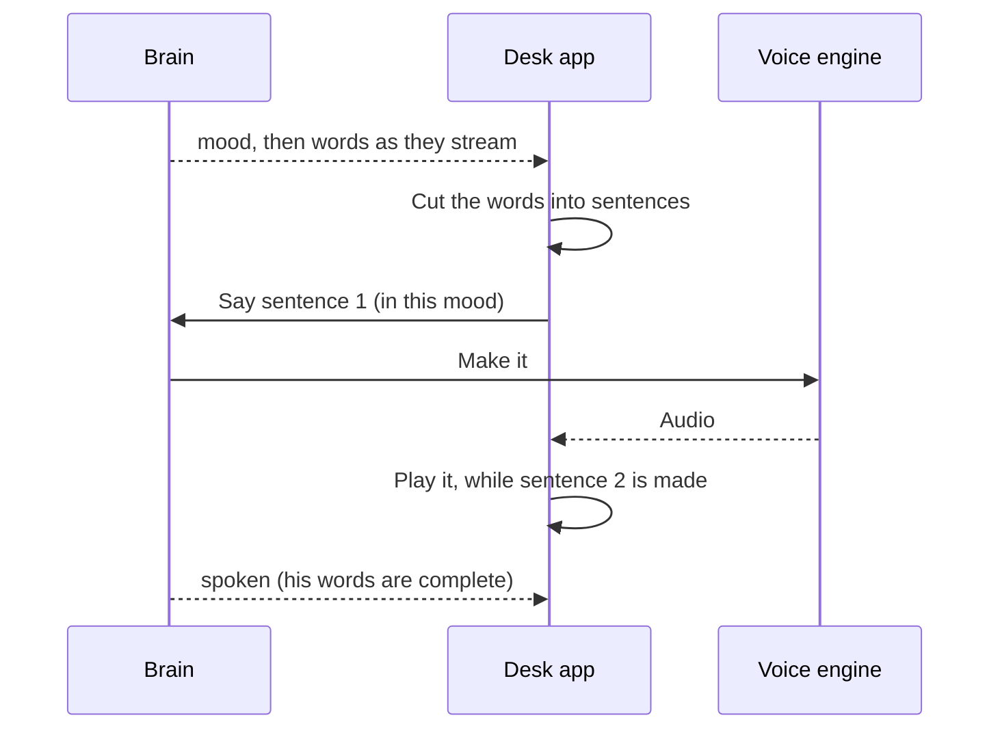

# Voice

> [!ABSTRACT] In short
> Kit speaks his replies through the desk PC's speakers in a voice of his own.
> The **voice engine** runs on the server's GPU as its own small program, and
> can be swapped (Chatterbox Turbo, Chatterbox, Kokoro, Piper). He speaks
> **sentence by sentence** as the brain writes, so he starts talking a few
> words in, not after the whole reply. His **mood** colours how he sounds.
> Hearing (a microphone, a wake word) is the next part of the stage.

## How a sentence becomes sound



- **The first sentence is cut short** where it can be, at its first comma
  ("Yeah, ...") or before an "and" or "but", because an engine like
  Chatterbox makes a whole piece before any of it plays.
- **One steady sound output** stays open while he talks, so there are no
  gaps and his first word isn't clipped.
- **His words show as he says them**, and his face acts the reply out as his
  voice starts (a Look page option).
- **You talking stops him**, straight away, mid-word.
- **Pipe-ups are said out loud too**, unless he's already talking.

## Engines

| Profile | Engine | Runs on | Mood shows as |
|---|---|---|---|
| `chatterbox-turbo` | Chatterbox Turbo, copies a reference clip | GPU | an opening sound: a sigh, a chuckle |
| `chatterbox` | Chatterbox, copies a reference clip | GPU | an emotion dial |
| `kokoro` | Kokoro, voice `af_heart` | CPU | speed |
| `piper` | Piper, `en_US-lessac-medium` | CPU | speed |
| `tone` | beeps, one per word | CPU | for testing |

Each engine runs as its own program with whichever Python has it installed,
since some need clashing libraries. Switching engines stops the old one,
which frees the GPU memory it held. Chatterbox copies whatever voice is in its
reference clip (`state/speech/kit_voice.wav` in the data folder), so changing
his voice is changing the clip.

## Try it

```
kit speech                          # engines, which one's in use, on or off
kit speech use chatterbox-turbo     # switch engine
kit speech on                       # speak replies in the desk app
kit speech say "Hey, how do I sound?" --mood happy
kit speech bench --engines chatterbox-turbo kokoro
```

## Go deeper
- [[Stage 3 - Voice]]: setting up each engine, changing his voice, moving
  Kit to another machine, and the test checklist.
- [[Desk App]]: where the sound comes out.

> [!under-the-hood]- Under the hood: the code
> - `src/kit/speech/service.py`: runs the chosen engine and asks it for speech.
> - `src/kit/speech/worker.py`: one engine behind a tiny local web server.
> - `src/kit/speech/sentences.py`: cutting words into speakable pieces.
> - `src/kit/speech/bench.py`: `kit speech bench`.
> - `src/kit/desk/voice.py`: playing it on the desk PC.
