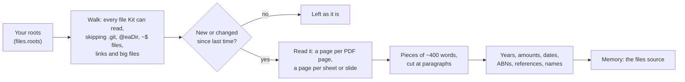

# Your Files

> [!ABSTRACT] In short
> You pick the folders (**roots**): a NAS share, a documents folder. Kit
> **reads every PDF, Word file, spreadsheet, slide deck and text file** in
> them into his memory as the `files` source, a page or sheet at a time, in
> pieces of about 400 words. He keeps up with new and changed files every half
> hour and never changes a thing in those folders. A folder you tick
> **private** stays with the local model once the file tools arrive.

## What it does

- "What did I pay for the rates last year?" needs the notice itself, not
  something you once said. With your finance folder as a root, the notice is
  in his memory, page by page, with its amount, year and reference number
  picked out.
- `kit memory search "rates notice 2025"` and the memory page find the right
  piece of the right file and show where it is: the root, the path and the
  page.
- In this first part he doesn't yet open files mid-chat. That's the file
  tools (part B2 of [[Stage 4 - Tools]]), which also bring the private rule.
  Until then your files stay out of what he recalls in conversation.

## How it works



| Kind | Read with | One page is |
|---|---|---|
| PDF | pypdf (OCR for scans if you turn it on) | a PDF page |
| Word (`.docx`) | python-docx, tables as tab-separated rows | the whole document |
| Excel (`.xlsx`, `.xlsm`) | openpyxl, up to `files.max_rows` rows a sheet | a sheet, titled by its name |
| Slides (`.pptx`) | python-pptx | a slide |
| Text, markdown, CSV | read as it is | the whole file |

- **Only what changed.** Each piece keeps its file's time and size, so a sync
  compares those and reads only new and changed files. A file that's gone
  leaves memory. A whole root that can't be reached (the NAS asleep) changes
  nothing, so a blip doesn't forget a share.
- **A file it can't read** (damaged, locked, a library missing) is listed in
  `kit files status` and not tried again until it changes.
- **A scan with no text** is kept by its name, so it's at least findable.
  Turn on **Read scans (OCR)** for that root to have its pages read.
- **Where a piece is from** is kept as `root:path` with forward slashes, never
  the full path, so moving a mount doesn't make him read everything again.
- **The register's names** (people, cars, places, see
  [[Register of Things]]) are marked in each piece they appear in.
- **First run.** Indexing a big share takes a while. Each file is saved as it's
  read, so an interrupted run picks up where it stopped. `kit files index`
  shows each file as it goes; the meaning vectors follow (see [[Memory]]).

### Choosing folders

The folders are **settings** you choose; Kit starts with none and reads
nothing until you add one. Three ways, all writing the same `files.roots`
table:

- **Settings page, "Your files":** add a folder by name and path (your NAS's
  read-only shares are offered as one-tap choices), tick Private or Read
  scans, or remove it. The path is checked on the server before it's saved.
- **`kit files add finance /mnt/nas/Finance`**, `kit files private finance on`,
  `kit files remove finance`.
- **`kit config set files.roots.finance.private true`** for a single change.

Removing a root takes what was read from it out of his memory (the folder
itself isn't touched). Ticking or unticking Private changes what's already
indexed straight away, without reading anything again.

## Try it

```
kit files add finance /mnt/nas/Finance
kit files index
kit files status
kit files search "rates notice 2025"
```

## Go deeper
- [[Memory In Depth]]: the knowledge index and how a source is added.
- [[Privacy]]: what's read, where it's kept, and private roots.
- [[Stage 4 - Tools]]: part B1's test checklist, and B2's file tools.
- [[Notes on the NAS]]: the notes vault, the one folder Kit may write to.

> [!under-the-hood]- Under the hood: the code
> - `src/kit/files/__init__.py`: `Root`, `roots_from`, and adding, changing
>   and removing roots in the settings.
> - `src/kit/files/walk.py`: `Walker` and `changes`.
> - `src/kit/files/extract.py`: each kind of file as pages of text.
> - `src/kit/files/fields.py`: years, amounts, dates, ABNs, references, names.
> - `src/kit/files/index.py`: `Files.sync`, `status`, `set_private`, `drop_root`.
> - `src/kit/routes/files.py`: the settings page's "Your files" (`/api/files`).
> - `src/kit/server.py`: the files loop (`files.sync_every_minutes`).
> - Install the readers with `pip install -e ".[files]"` (and `".[ocr]"` for
>   scans), from `pyproject.toml`.
> - Settings: [[Settings Reference#files]].
