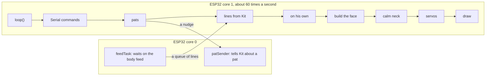

# The Pod in depth

Up: [[Home]] · Deep dives · [[The Pod]]

The Pod is an ESP32 with a screen, two servos and a touch pad, running one
Arduino program. Everything Kit *is* stays on the server; this page is how the
Pod draws him, moves him, feels a pat and keeps in step with the brain. To
build one, follow [[Building the Pod]].

![[pod-v2-inside.jpg|420]]

*Inside: the screen at the front of the head, the tilt servo behind it, the
turn servo under the neck, and the ESP32 in the base.*

## The parts

| Part | What it does |
|---|---|
| ESP32-WROOM-32 dev board | Runs the program; Wi-Fi to the brain and for uploads |
| 1.5" SSD1351 colour OLED, 128 x 128 | His face |
| SG90 servo in the body | Turns the head left and right (the "turn" servo) |
| SG90 servo in the head | Nods the head up and down (the "tilt" servo) |
| A wire to a touch pad on top | The pat sensor (the ESP32's own touch input, no extra board) |
| 3D-printed parts | Head, face plate, neck, body, base and trims; see `pod/cad/README.md` |

## Wiring

| From | To the ESP32 |
|---|---|
| Screen VCC | 3V3 |
| Screen GND | GND |
| Screen DIN | D23 |
| Screen CLK | D18 |
| Screen CS | D5 |
| Screen DC | RX2 (GPIO 16) |
| Screen RST | TX2 (GPIO 17) |
| Turn servo orange (signal) | D13 |
| Tilt servo orange (signal) | D14 |
| Both servos red (power) | VIN (the USB 5 V) |
| Both servos brown (ground) | GND |
| Pat wire | D32 (touch pin T9) |

> [!WARNING] Uploading by USB
> Unplug the two servo red wires while uploading over USB, and hold **BOOT**
> while it says "Connecting...". Servos starting up can pull the board's power
> down mid-upload. Uploads over Wi-Fi don't need either.

## How the program is laid out

Everything is in `pod/firmware/kit_pod_face/kit_pod_face.ino`, in sections in
this order:

| Section | What it does |
|---|---|
| pins and servo setup | Pins, the neck's centre and range, the calm neck's settings, the face's size |
| state | His mood, state (awake, sleeping, thinking, speaking...), the neck's targets |
| gestures | Plays the 19 gestures as timed curves, the same maths as the desk's rig |
| one frame of the face | Draws eyes, lids, brows, mouth and blush into a frame buffer and sends it to the screen |
| the link to Kit's brain | The body feed and pats (below) |
| the calm neck | Decides *when* the head moves, then eases it there |
| servos | Turns the head's angle into servo pulses, and lets go when still so they don't buzz |
| the servo tuning page | The page that drives the servos by hand and saves the neck's centre, range and direction |
| Wi-Fi uploads | ArduinoOTA, with a progress bar on his face |
| input | Serial commands, pats and his life on his own |
| each frame | Blends the pose, blinks, eye darts and breathing into one frame |
| main | `setup()` and `loop()` |



The two cores are why the face never stutters: a slow network only ever
delays the helper on core 0, and lines reach the face through a queue.

### His face, from the same sheet

The face is a port of the desk's Glow painter and rig (`src/kit/desk/glow.py`
and `src/kit/face/rig.py`) using the `kit2d_screen` look of
`src/kit/face/characters/kit2d.json`. `pod/firmware/kit_pod_face/make_sheet.py`
turns the sheet into `kit2d_sheet.h` (moods, colours, poses, gestures and state
rules as C tables), so a mood or gesture retuned on the desk reaches the Pod
with one command and an upload:

```
cd pod/firmware/kit_pod_face
python make_sheet.py
```

`FACE_ZOOM` (1.15) draws the face a little larger than the sheet, because the
Pod's screen is small. The face's own life (blinks, eye darts, breathing) runs
on the Pod, so it stays alive between lines from the brain.

## The body feed

The brain keeps a plain-text feed for small bodies. The Pod keeps one request
open and the brain answers as soon as there's something new (a long poll),
with Kit's token in the `Authorization: Bearer` header.

| Request | What it does |
|---|---|
| `GET /api/body/feed` | Just started: how Kit is right now, no old events |
| `GET /api/body/feed?after=N&wait=20` | Everything after line `N`; waits up to 20 s for something to happen |
| `POST /api/body/touch` | A pat on his head. Kit feels warm about it |

Every answer is one line per thing, and the last line says where it got to:

| Line | What the Pod does |
|---|---|
| `face fond` | His resting face, from Kit's mood and feelings. Shown whenever no reply's emotion is |
| `asleep 1` / `asleep 0` | Yawns and sleeps (head down, eyes shut) / perks up awake |
| `energy 0.62` | How lively Kit is, 0 to 1: how often he glances round and how fast the neck moves |
| `emotion happy` | A reply's emotion: shown for 6 s, then back to the resting face |
| `talk thinking` | Kit is working on a reply: the thinking face |
| `talk speaking 3.8` | Kit is saying something for 3.8 s: the mouth moves |
| `talk done` | Finished thinking |
| `fidget yawn` | A little idle move, on the face only |
| `gesture nod` | A real reaction: face and neck |
| `look -0.40 0.12` | Where his eyes (the camera) see the person: left -1 to right 1, up -1 to down 1 |
| `turn_to 0.3 0` | Kit is talking to someone in the room: face them for 5 s |
| `last 120` | Ask for lines after 120 next time |

Lines are short on purpose: the Pod reads them with `sscanf` and no JSON
library. A line it doesn't know is ignored, so the brain can add lines
without breaking older Pods.

> [!NOTE] Where the brain's side is
> The feed, pats and `turn_to` are pull request #36, which also teaches Kit
> who in the room can hear him. Until it's merged, a Pod with `KIT_URL`
> set says "Can't reach Kit" in the Serial Monitor and carries on by itself.

### Linked and on his own

- **Linked** (heard from the brain in the last minute): his face, sleep and
  liveliness come from Kit. His own idle moods and dozing are off. The Serial
  Monitor says "Linked to Kit's brain".
- **Lost Kit** (nothing for 60 s, `LINK_LOST_MS`): he wakes up if he was
  thinking or talking and runs on his own until the brain is back.
- **On his own** (no `KIT_URL`, or no brain): every 9 to 22 s a calm mood or a
  small move (look away, tilt, peek, shrug, nod, wiggle), and he dozes off
  after 3 minutes alone (`DOZE_AFTER_MS`). A pat wakes him.

### Pats

The pat pad is the ESP32's touch input on D32: at start-up it measures the
pad, and a reading under 70% of that is a touch.

| Pat | He... |
|---|---|
| One | goes fond and does a happy wiggle |
| Three within 4 s | goes happy and laughs |
| While asleep | wakes up, fond |

The pat face shows for 6 s, then his resting face, and the pat goes up to the
brain on the second core so the face doesn't wait.

## The calm neck

The first program moved the servos about 26 times a minute. The fix: **the face is lively, the neck is not.** The eyes dart about on the screen,
and the head only moves when Kit pays attention to something:

1. **A glance round the room** now and then: about every 5 minutes when he's
   calm, every 50 s when he's lively, never within 20 s of the last look.
2. **Something catching his eye**: someone appearing, or moving somewhere new,
   in front of Kit's [[Eyes]]. The eyes jump there first and the head follows,
   quicker than a glance.
3. **Following you** for 8 to 25 s now and then while someone's in view (about
   every 3 minutes when calm, 45 s when lively).
4. **Facing someone** Kit is talking to by name ("Hi Sam!") for 5 s.
5. **A real gesture** (a nod, a shake, perking up). Fidgets stay on the face.
6. **His mood's posture**: a droop when he's sad, head down asleep.

Turns under 9 degrees and tilts under 4 are left to the eyes, every move is
eased in and out, and the head holds still for 3 s after each move. A 10-minute
idle simulation went from about 26 servo moves a minute to under one.

| Setting (top of the program) | Default | What it does |
|---|---|---|
| `DEFAULT_TURN_CENTRE`, `DEFAULT_TILT_CENTRE` | 90 | Where he faces straight ahead and level, until you tune it |
| `DEFAULT_TURN_RANGE`, `DEFAULT_TILT_RANGE` | 35, 18 | How far each way, in degrees, until you tune it |
| `TUNE_LETGO_MS` | 15000 | The tuning page hands the neck back this long after it goes quiet |
| `TUNE_SPEED` | 60 | Degrees a second when the tuning page moves a servo |

The real centre, range and direction (which way is left, which way is up) are
set on the servo tuning page, below, and kept in the Pod's memory.
| `NECK_DEADBAND_TURN`, `NECK_DEADBAND_TILT` | 9, 4 | Smaller moves are left to the eyes |
| `NECK_HOLD_MS` | 3000 | The head stays put this long after a move |
| `NECK_SPEED_CALM`, `NECK_SPEED_LIVELY`, `NECK_SPEED_NOTICE` | 30, 80, 120 | Degrees a second: sleepy, lively, "what's that?" |
| `GLANCE_EVERY_CALM_S`, `GLANCE_EVERY_LIVELY_S` | 300, 50 | Roughly how often he glances round |
| `NECK_GESTURE_SIZE` | 0.7 | How big gestures are on the neck |
| `FOLLOW_MIN_MS`, `FOLLOW_MAX_MS` | 8000, 25000 | How long he follows you once he starts |
| `FOLLOW_EVERY_CALM_S`, `FOLLOW_EVERY_LIVELY_S` | 180, 45 | Roughly how often he starts following you |
| `EMOTION_HOLD_MS`, `TURN_TO_HOLD_MS` | 6000, 5000 | How long a reply's emotion, and facing someone, last |
| `DOZE_AFTER_MS` | 3 minutes | Alone this long and he dozes (only when not linked) |

The servos are let go 0.4 s after the head stops, so they don't hum or buzz
while he's still.

## Talking to him over USB

Open the Arduino Serial Monitor at **115200** and type:

| Type | He... |
|---|---|
| a mood: `happy`, `sad`, `curious`, ... (all 20) | shows it |
| a gesture: `nod`, `wink`, `laugh`, ... (all 19) | plays it, on the neck too |
| `sleep`, `wake`, `listen`, `think`, `talk`, `offline`, `awake` | goes into that state |
| `look` | something catches his eye at a random spot |
| `look -0.8` or `look 0.5 -0.3` | ...at that spot (left -1 to right 1, then up -1 to down 1) |
| `glance` | glances round now |
| `tour` | shows every mood in turn (again to stop) |
| `still` | servos off, or on again |
| `help` | lists all of the above |

> [!example]- All 20 moods and 19 gestures
> **Moods:** neutral, happy, curious, thinking, surprised, concerned, playful,
> tired, proud, excited, sad, confused, shy, grumpy, focused, relieved, fond,
> scared, sleepy, dreaming.
>
> **Gestures:** nod, shake, tilt_head, perk_up, droop, look_away, shrug, wave,
> bounce, lean_in, wink, laugh, sigh, startle, yawn, double_take, wiggle,
> peek, look_up.
>
> ![[pod-screen-gestures.png]]

## The servo tuning page

Once he's on Wi-Fi the Pod serves a small web page at `http://kit-pod.local`
(or the address the Serial Monitor prints). Open it in any browser on the PC
or a phone; nothing to install, and it works without the internet.

![[pod-servo-tuning.png]]

| Part of the page | What it's for |
|---|---|
| Fit the horns | Both servos to 90 degrees, held, while you push the neck onto the turn servo and slide the tilt servo onto its horn |
| Turn, Tilt | Move each servo by hand: slider, 1 and 5 degree nudges, each end of its range, a sweep. Set its centre, range and direction |
| Check with Kit | Look left, right, up and down, nod, shake and glance, done by Kit himself, so you see his eyes and head agree |
| Keep it | Save in the Pod, give the neck back, go back to the starting values, or free movement (anywhere 0 to 180 degrees, to find where the head touches) |

While the page has the neck, the calm neck stops and the servos hold where the
page puts them, moving at 60 degrees a second; his face carries on. The page
keeps the neck while it's open; close it (or press Esc) and he takes it back
15 s later, easing to centre. The arrow keys turn and tilt him once the
directions are right. A horn only goes on a whole spline tooth at a time, so
"Centre" is how you take out the last few degrees.

Saved settings live in the ESP32's own storage (Preferences, namespace `pod`),
so a restart or a new upload keeps them. The page talks to these addresses,
all plain GET requests that answer with the neck's state as JSON:

| Address | Does |
|---|---|
| `/state` | Just the state (`?hold=1` keeps the neck while the page is open) |
| `/move?turn=95&tilt=88`, `/move?dturn=-1` | Takes the neck and moves to raw servo degrees, or nudges |
| `/centre`, `/fit` | Both to centre, or both to 90 with free movement |
| `/free?on=1` | Free movement on or off |
| `/set?tc=92&tr=35&ts=1&lc=90&lr=16&ls=-1` | Centre, range and direction (1 or -1) for turn and tilt |
| `/save`, `/defaults` | Saves them in the Pod, or goes back to the starting values |
| `/release` | Gives the neck back to Kit |
| `/cmd?c=nod` | Any Serial Monitor command, after giving the neck back |

## Uploads over Wi-Fi

After the first USB upload the Pod joins the home Wi-Fi as `kit-pod` and
listens for new programs (ArduinoOTA). In the Arduino app, **Tools > Port**
shows "kit-pod at 192.168...", and **Upload** sends the program over Wi-Fi
after asking for the upload password. His face shows a progress bar, the
servos go limp, and he restarts. The board needs a partition scheme with room
for two programs: "Default 4MB with spiffs".

## Reaching Kit inside WSL

Kit's brain runs in Ubuntu under WSL on the Windows PC, behind WSL's own
private network. The Pod is on the home Wi-Fi, so Windows has to pass port
8600 through:


- `pod/network/kit-port-forward.ps1` points a Windows `netsh` port proxy at
  WSL's current address (it can change at each restart). With `-Install` it
  registers a task that runs it at every logon.
- A Windows Firewall rule lets port 8600 in on the home (Private) network.
- `KIT_URL` in the Pod's `kit_server.h` is the PC's address on the home
  network, like `http://192.168.1.20:8600`.

The steps are in [[Building the Pod#7. Link him to Kit]].

## His files

| File | What it is |
|---|---|
| `pod/firmware/kit_pod_face/kit_pod_face.ino` | The whole program |
| `pod/firmware/kit_pod_face/tuning_page.h` | The servo tuning page, as one HTML string |
| `pod/firmware/kit_pod_face/kit2d_sheet.h` | Kit 2D's moods, poses and gestures as C tables, made by `make_sheet.py` |
| `pod/firmware/kit_pod_face/wifi_settings.example.h` | Copy to `wifi_settings.h`: Wi-Fi name and password, upload password, network name |
| `pod/firmware/kit_pod_face/kit_server.example.h` | Copy to `kit_server.h`: Kit's address and token |
| `pod/firmware/kit_pod_screen_test/kit_pod_screen_test.ino` | Bench test for the screen alone: red, green and blue, then eyes blinking and glancing |
| `pod/firmware/kit_pod_servo_test/kit_pod_servo_test.ino` | Bench test for the servos alone: both to centre, turn left and right, nod up and down |
| `pod/cad/kit_pod_v2.py` | Every printed part, as CadQuery code |
| `pod/cad/render_pod.py`, `pod/cad/render_steps.py` | The renders and the assembly pictures in these docs |
| `pod/network/kit-port-forward.ps1` | The Windows port forward to WSL |

> [!DANGER] Secrets
> `wifi_settings.h` and `kit_server.h` hold your Wi-Fi password and Kit's
> token. They're in `.gitignore`; only the `.example.h` copies are in the repo.

## Two faces to choose from

The face plate comes in two versions; print both and keep the one you like.

![[pod-face-options.jpg]]

*Left, screws: four M2 screws go in from the back, through the board into the
plate's posts, so nothing shows from the front and the screen comes out again.
Right, pins: the screen presses onto four printed pins with a dab of hot glue.*

## What's next for the Pod

- **His voice in the room**: a MAX98357A amplifier and a small speaker in the
  body (the dimples on its side are for it). His voice is still made on the
  server and streamed to the Pod; the desk stays quiet while the Pod talks.
- **His ears**: an INMP441 microphone. Pat-to-talk first, then "Kit" as a
  wake word, with speech-to-text on the server. The mic is muted while he
  talks.
- **One voice at a time**: a reply comes out of the body you spoke to, and he
  finishes one spoken conversation before turning to the next person.

See [[Roadmap]] and [[Bodies]].
