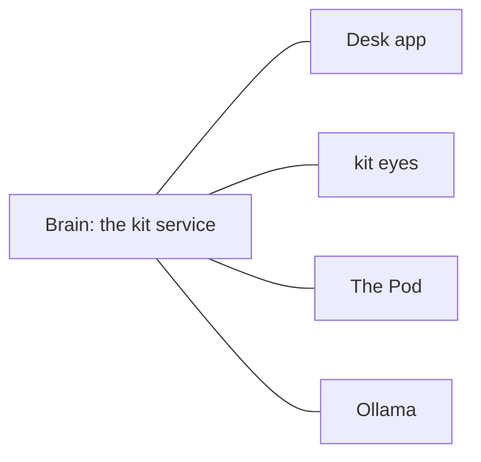

# Running Kit

Up: [[Home]] · Guides

> [!ABSTRACT] In short
> Kit's **brain** is a service on the server: `sudo systemctl restart kit`
> restarts him and `kit check` says if anything's wrong. His **eyes** are
> `kit eyes` on the PC with the webcam. The **desk app** and the **Pod** look
> after themselves: they reconnect on their own whenever the brain comes back.

## What runs where

| Piece | Where | Starts by itself? | Restart it with |
|---|---|---|---|
| **Brain** (chat, memory, moods, voice) | Ubuntu (WSL) on the server PC | Yes, as the `kit` service | `sudo systemctl restart kit` |
| **Local model** (Ollama) | Same server | Yes, as the `ollama` service | `sudo systemctl restart ollama` |
| **Desk app** (tray face, chat) | The Windows desk PC | Yes, at logon | Tray menu > **Quit Kit**, then **Kit** from the Start menu |
| **Eyes** (webcam) | The PC with the webcam | Only if you set up a logon task | Ctrl+C, then `kit eyes` again |
| **The Pod** | On the desk, on Wi-Fi | Yes, when it has power | Unplug and plug in the USB |



Everything else talks to the brain, so **restarting the brain is the fix for
most things**, and the rest catch up by themselves within a minute.

## The brain, on the server

Open the Ubuntu terminal, then:

```
cd ~/Kit
source .venv/bin/activate        # once per terminal, so the kit command works
```

| To... | Run |
|---|---|
| Restart Kit | `sudo systemctl restart kit` |
| Stop Kit | `sudo systemctl stop kit` |
| Start Kit | `sudo systemctl start kit` |
| See if he's running | `systemctl status kit` (look for **active (running)**) |
| Watch what he's doing | `journalctl -u kit -f` (Ctrl+C stops watching, not Kit) |
| See why he stopped | `journalctl -u kit -n 100` |
| Check the whole setup | `kit check` (every line should say PASS) |
| Get his token, for a new app or body | `kit token` |
| Back up his memory now | `kit memory backup` |
| Chat in the terminal | `kit chat` |
| See how he's feeling | `kit life` |
| Run him by hand, to try something | `sudo systemctl stop kit`, then `kit serve` (Ctrl+C, then `sudo systemctl start kit` when done) |

From any other machine, `http://kit-server:8600/api/health` answers if he's up.

> [!TIP] The Ubuntu side stays up by itself
> The **Kit WSL** scheduled task on Windows keeps Ubuntu running, and the
> service starts Kit when Ubuntu starts. After a Windows restart, sign in and
> give it a minute. See [[Stage 0 - Server Setup]].

## Updating

```
cd ~/Kit
git pull
source .venv/bin/activate
pip install -e .
sudo systemctl restart kit
kit check
```

Trying a pull request first, going back, and updating the eyes and the voice
are in [[Updating Kit]].

## His voice

The brain starts the voice engine itself, so restarting Kit restarts it too.

| To... | Run |
|---|---|
| See which voice is on | `kit speech` |
| Hear a line | `kit speech say "Hello there"` |
| Turn speaking off or on | `kit speech off` / `kit speech on` |
| Fall back to the light voice | `kit speech use kokoro` |
| Back to the main voice | `kit speech use chatterbox-turbo` |

The voice's log is `logs/speech.log` in the data folder. See [[Voice]].

## The desk app

- **Start:** **Kit** in the Windows Start menu. It also starts at logon.
- **Stop:** right-click the tray face > **Quit Kit**.
- **Grey face:** he can't reach the brain. Check the brain's running; the app
  reconnects on its own.
- **Update:** tray menu > **Check for updates**. It also checks daily and asks
  before installing.

See [[Desk App]] and [[Stage 2 - Desk App]].

## His eyes, on the PC with the webcam

In PowerShell, in the eyes' copy of Kit:

```powershell
cd C:\path\to\Kit
.eyes\Scripts\activate
kit eyes              # run them, headless; Ctrl+C stops them
```

| To... | Run |
|---|---|
| Run them with a window to watch | `kit eyes --show` |
| See what Kit can see right now | `kit eyes show` |
| Switch them off (camera released) / on | `kit eyes pause` / `kit eyes resume`, or **Let Kit see me** in the tray menu |
| List the cameras | `kit eyes cameras` |
| Point them at the brain (once) | `kit eyes connect http://kit-server:8600 TOKEN` |
| Introduce yourself / someone | `kit eyes enrol me` / `kit eyes enrol NAME` |
| Who they know | `kit eyes faces` |
| Restart them | Ctrl+C, then `kit eyes` |
| Update them | `git pull`, then restart them |

Only one program can use the webcam at a time, so stop `kit eyes` before
`kit eyes enrol`. To start them with Windows, see
[[Vision Stage 1#4. Open them]]. More in [[Eyes]].

## The Pod

- **Start:** plug in his USB power. He perks up, joins Wi-Fi and, once
  `kit_server.h` is filled in, links to the brain by himself.
- **Restart:** unplug and plug in again.
- **If the brain goes away**, he runs on his own after a minute and links
  again as soon as it's back. Nothing to do.
- **To talk to him directly:** the Arduino Serial Monitor at 115200 over USB.
  `help` lists what he does; `still` switches the servos off.
- **After a Windows restart**, the port forward that lets him reach the brain
  runs by itself at logon (`kit-port-forward.ps1`).
- **New program:** Arduino app > **Tools > Port > kit-pod**, Upload.

See [[The Pod]] and [[Building the Pod]].

## When something's off

| What you see | Try |
|---|---|
| Nothing answers anywhere | `systemctl status kit`; if it's not running, `journalctl -u kit -n 100` says why |
| The desk face is grey | The brain is down or unreachable: restart Kit, check `kit-server` answers |
| He answers but won't speak | `kit speech`; `logs/speech.log`; `kit speech use kokoro` to get a voice back |
| The eyes say they can't reach Kit | `kit eyes connect` again with the address and `kit token` |
| The Pod says "Can't reach Kit" | Run `kit-port-forward.ps1` on Windows again; check `/api/health` from a phone |
| A setting change broke something | `kit config undo` |
| Something odd after an update | `kit check`, then see [[Updating Kit#If something's off]] |

Every command is in [[Commands]]; where Kit keeps his files is in
[[Settings and Data]].
