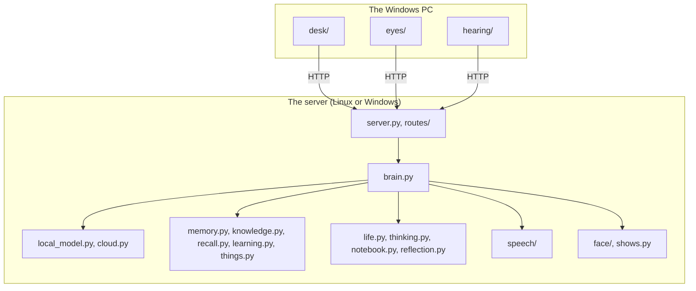

# Code map

Up: [[Home]] · Reference

Every Python module in `src/kit`, grouped by the part of Kit it belongs to,
with the note that explains it in plain words. Each module opens with a
docstring that says the same in more detail, so this is the place to jump
from a note into the code. A test checks every module is listed here.

## The brain

| Module | What it does | Explained in |
|---|---|---|
| `src/kit/server.py` | The web server: builds the app around the routes, and runs the background loops | [[API]], [[The Big Picture]] |
| `src/kit/routes/state.py` | What every route shares: the one `AppState`, the token checks, answer helpers | [[API]], [[Phone App]] |
| `src/kit/routes/pages.py` | The chat, settings and memory pages | [[API]] |
| `src/kit/routes/status.py` | `/api/health`, `/api/status` and cloud spend | [[API]] |
| `src/kit/routes/chat.py` | `/api/chat` (streamed) and the conversation so far | [[API]], [[Life of a Message]] |
| `src/kit/routes/settings.py` | Reading, changing and undoing settings | [[API]], [[Settings and Data]] |
| `src/kit/routes/memory.py` | Facts, memory search and day summaries | [[API]], [[Memory]] |
| `src/kit/routes/things.py` | The register of things over the API | [[API]], [[Register of Things]] |
| `src/kit/routes/files.py` | The settings page's "Your files": roots, their status, syncing now | [[API]], [[Your Files]] |
| `src/kit/routes/tools.py` | The packs and tools over the API, and running one by hand | [[API]], [[Tools and Packs]] |
| `src/kit/routes/life.py` | Kit's mood, notebook, life events, and piping up now | [[API]], [[Inner Life]] |
| `src/kit/routes/desk.py` | The desk app's PC reports, and claiming and answering desk commands | [[API]], [[Desk App]] |
| `src/kit/routes/eyes.py` | The eyes' reports, known faces and the "Let Kit see me" switch | [[API]], [[Eyes]] |
| `src/kit/routes/face.py` | The character sheet and the 3D face page's files | [[API]], [[Face]] |
| `src/kit/routes/bodies.py` | A body's hello, pairing devices, and the list of both | [[API]], [[Phone App]] |
| `src/kit/routes/hearing.py` | The ears' reports, what was heard, hush and pause, and known voices | [[API]], [[Hearing]] |
| `src/kit/routes/speech.py` | Voice status and one sentence of speech, streamed or as a WAV | [[API]], [[Voice]] |
| `src/kit/brain.py` | The conversation loop: one message in, a streamed reply out | [[Brain]], [[Life of a Message]] |
| `src/kit/reply.py` | The shape of every reply, emotions, gestures and actions | [[Brain#One shape for every reply]] |
| `src/kit/prompt.py` | What a model sees each turn | [[Life of a Message]] |
| `src/kit/tools/__init__.py` | Tools, packs and the registry: what a model can call mid-answer, offered only where there's something to look at | [[Tools and Packs]] |
| `src/kit/tools/core.py` | The core pack: recall, look at the PC, look around, the forecast, read a note | [[Tools and Packs]] |
| `src/kit/tools/files.py` | The files pack: find, read and list your documents from the index | [[Your Files#Asking about them]] |
| `src/kit/tools/pc.py` | The pc pack: open files, folders, apps and sites on the PC, bring a window up, the media keys, what you worked on and your code projects | [[Desk App#Doing things on the PC]], [[Tools and Packs#Packs]] |
| `src/kit/tools/notes.py` | The notes pack: find notes, list tasks, add under a heading, edit, tick, start, open in Obsidian and undo | [[Notes on the NAS#Changing a note]] |
| `src/kit/tools/mcp.py` | Your apps as packs: each app's MCP server connected, its tools wrapped with what they do, reconnecting, and its saved work into memory | [[Other Apps#Apps as packs]] |
| `src/kit/tools/house.py` | The house pack: find, read and switch lights, the aircon, scenes, blinds and locks, and who's home | [[The House#The tools]] |
| `src/kit/tools/match.py` | Which packs a message loads: always, words, register links, then meaning | [[Tools and Packs#Which packs load]] |
| `src/kit/tools/confirm.py` | Asking first: which tools wait for a yes, the held call, what the model is told | [[Tools and Packs#Asking first]] |
| `src/kit/tools/private.py` | A private result as a local summary for a cloud model | [[Tools and Packs#Private results]], [[Privacy]] |
| `src/kit/channels.py` | Where you're talking from: desk, voice, phone, web, home, terminal | [[Brain#Where you're talking from]] |
| `src/kit/local_model.py` | The local model, through Ollama | [[Models and Routing]] |
| `src/kit/cloud.py` | Claude, GPT and Gemini behind one interface, with caching and spend | [[Models and Routing]] |
| `src/kit/prices.py` | What models cost: the price list and exchange rate, fetched daily, in Australian dollars | [[Models and Routing#Prices, fetched for you]] |
| `src/kit/cli.py` | The `kit` command | [[Commands]] |
| `src/kit/__main__.py` | `python -m kit` runs the `kit` command | [[Commands]] |

## Memory

| Module | What it does | Explained in |
|---|---|---|
| `src/kit/memory.py` | The SQLite memory file, migrations, backups, spend | [[Memory]], [[Memory In Depth]] |
| `src/kit/knowledge.py` | One index for everything Kit knows, by words and meaning | [[Memory In Depth#One index for everything Kit knows]] |
| `src/kit/embed.py` | Meaning vectors from the embedding model | [[Memory]] |
| `src/kit/recall.py` | Finding what matters right now | [[Memory#Finding things]] |
| `src/kit/learning.py` | Adding facts tidily, and each day's summary | [[Memory#Learning without a mess]] |
| `src/kit/things.py` | The register of things | [[Register of Things]] |
| `src/kit/mcp_client.py` | The small MCP client: initialize, list and call tools, over HTTP or a program's input and output | [[Other Apps#Apps as packs]] |
| `src/kit/notes.py` | The notes vault on the NAS: reading, taking notes, its shape and the Sunday report | [[Notes on the NAS]] |
| `src/kit/notes_tasks.py` | The open tasks in a note and their due dates, as the `tasks` source | [[Notes on the NAS#Finding notes and tasks]] |
| `src/kit/notes_edit.py` | Changing a note: add, edit, tick, start; shown first, never over your own edit, and undo | [[Notes on the NAS#Changing a note]] |
| `src/kit/files/__init__.py` | Your folders (roots) and adding, changing and removing them in the settings | [[Your Files]] |
| `src/kit/files/walk.py` | Finding the files under each root, and what's new, changed and gone | [[Your Files#How it works]] |
| `src/kit/files/extract.py` | A PDF, Word file, sheet, slide deck or text file as pages of text | [[Your Files#How it works]] |
| `src/kit/files/fields.py` | Years, amounts, dates, ABNs, references and names in a piece of a file | [[Your Files#How it works]] |
| `src/kit/files/index.py` | Keeping the `files` source in step with the folders | [[Your Files]], [[Memory In Depth]] |
| `src/kit/house/__init__.py` | The house through Home Assistant, and its memory source's name | [[The House]] |
| `src/kit/house/client.py` | The Home Assistant WebSocket client: auth, reconnecting, events, reads and service calls | [[The House]] |
| `src/kit/house/model.py` | The exposed things and rooms, kept current, and finding the thing you mean | [[The House#Finding the thing you mean]] |
| `src/kit/house/noticing.py` | What he notices in the house: got home, a door after dark, a light left on | [[The House#Noticing]] |
| `src/kit/house/contents.py` | The house's things and rooms as the `house` source in memory | [[The House#In his memory]] |

## Inner life and companionship

| Module | What it does | Explained in |
|---|---|---|
| `src/kit/life.py` | Drives, mood, feelings, sleep, pipe-ups, hellos, games, events for bodies | [[Inner Life]], [[Inner Life In Depth]] |
| `src/kit/thinking.py` | His private thoughts | [[Inner Life#Thoughts and his notebook]] |
| `src/kit/notebook.py` | His notebook: thoughts, opinions, wants, threads, journal | [[Inner Life#Thoughts and his notebook]] |
| `src/kit/reflection.py` | The nightly look back and weekly review | [[Inner Life#Each night he looks back]] |
| `src/kit/daily.py` | Once-a-day questions and nudges | [[Companion]] |
| `src/kit/pastimes.py` | What he does while you're out | [[Companion#While you're out]] |
| `src/kit/noticing.py` | The small moments his eyes catch that he feels: waves, thumbs, smiles, frowns, sleepy eyes | [[Eyes#Moments he feels]] |
| `src/kit/when.py` | "Thursday arvo" and friends, and how long something took ("25 min") | [[Time and Weather]] |
| `src/kit/holidays.py` | The shape of the week and public holidays | [[Time and Weather]] |
| `src/kit/weather.py` | The forecast from Open-Meteo | [[Time and Weather]] |
| `src/kit/shows.py` | The time, date and weather on his face | [[Face]] |

## What he senses

| Module | What it does | Explained in |
|---|---|---|
| `src/kit/desk_commands.py` | Asking the desk app to do something on the PC: the `desk_command` event, the claim, the answer, the wait | [[Desk App#Doing things on the PC]], [[API]] |
| `src/kit/brief.py` | The morning brief: its parts, when it's due, the desk pipe-up and the reply aside, "the second one" | [[Companion#The morning brief]] |
| `src/kit/activity.py` | What you did on the PC each day, kept as one `activity` item a day | [[Desk App#What you worked on]], [[Memory In Depth]] |
| `src/kit/projects.py` | Your code projects, refreshed into the index once a day | [[Desk App#What you worked on]], [[Memory In Depth]] |
| `src/kit/pc_context.py` | The brain's side of what's on the PC | [[Desk App#What Kit learns from the PC]] |
| `src/kit/scene_context.py` | The brain's side of what the eyes see | [[Eyes]] |
| `src/kit/known_faces.py` | The people his eyes know | [[Eyes]] |
| `src/kit/heard.py` | The brain's side of what the ears hear: spoken to, a laugh, an echo, tone, who | [[Hearing]] |
| `src/kit/known_voices.py` | The people his ears know, by voice print | [[Hearing]] |
| `src/kit/body_registry.py` | Bodies saying hello, the brain's features, and which bodies are around | [[Phone App#Saying hello]], [[Bodies]] |
| `src/kit/devices.py` | Paired devices, each with a token of its own (`kit pair`) | [[Phone App#Pairing]] |

## Bodies

| Module | What it does | Explained in |
|---|---|---|
| `src/kit/body.py` | The plain-text body feed, chat moments and pats | [[Pod In Depth#The body feed]] |
| `src/kit/audience.py` | Who can hear him, and who his words are for | [[Bodies#Who can hear him]] |

## Setup and settings

| Module | What it does | Explained in |
|---|---|---|
| `src/kit/paths.py` | The data folder and everything in it | [[Settings and Data]] |
| `src/kit/settings.py` | Every setting, its default and description | [[Settings Reference]] |
| `src/kit/settings_store.py` | Changing settings, history, undo | [[Settings and Data#Changing settings]] |
| `src/kit/credentials.py` | API keys and the token | [[Settings and Data#Secrets]] |
| `src/kit/checks.py` | `kit check` | [[Stage 0 - Server Setup]] |
| `src/kit/evals.py` | The eval suites | [[Evals]] |
| `src/kit/evals_cli.py` | `kit eval`: runs each eval against the real models and prints how it went | [[Evals]], [[Commands]] |
| `src/kit/settings.example.toml` | An example settings file | [[Settings Reference]] |
| `src/kit/docs_check.py` | `kit docs check`: the stale rows of Where Kit Is Up To | [[Commands#The docs]] |

## Face

| Module | What it does | Explained in |
|---|---|---|
| `src/kit/face/rig.py` | Emotions, gestures and states into face numbers | [[Face#The rig, in three layers]] |
| `src/kit/face/character.py` | Loading and checking character sheets | [[Face In Depth]] |
| `src/kit/face/body.py` | Whole-body moves | [[Face#Body moves]] |
| `src/kit/face/serve.py` | The 3D face page's files | [[Face#Kit 3D, live from the brain]] |
| `src/kit/face/characters/` | `retro.json`, `kit2d.json`, `kit3d.json` and the 3D pack | [[Face In Depth]] |
| `src/kit/web/` | The chat, settings and memory pages, and the 3D face page | [[API]] |

## Voice

| Module | What it does | Explained in |
|---|---|---|
| `src/kit/speech/service.py` | Runs the chosen engine and asks it for speech | [[Voice]] |
| `src/kit/speech/worker.py` | One engine behind a tiny local web server | [[Voice#Engines]] |
| `src/kit/speech/link.py` | Kit's end of the voice link: lines to the voice program, its sound back | [[Voice#His voice from another computer]] |
| `src/kit/speech/program.py` | The voice program (`kit voice`): an engine on another computer's card, dialling in | [[Voice#His voice from another computer]] |
| `src/kit/speech/turbo.py` | Chatterbox Turbo's token loop recorded as a CUDA graph | [[Voice#Faster on a graphics card]] |
| `src/kit/speech/sentences.py` | Cutting words into speakable pieces | [[Voice]] |
| `src/kit/speech/bench.py` | `kit speech bench` | [[Commands#Voice]] |

## The desk app (Windows only)

| Module | What it does | Explained in |
|---|---|---|
| `src/kit/desk/app.py` | The tray, the face window, the threads that talk to the brain | [[Desk App]] |
| `src/kit/desk/client.py` | Talking to the brain | [[API]] |
| `src/kit/desk/config.py` | The desk app's own settings, and the hidden apps and words | [[Privacy]] |
| `src/kit/desk/chat.py` | The chat window | [[Desk App]] |
| `src/kit/desk/window.py` | Kit's window and its pages | [[Desk App]] |
| `src/kit/desk/mood.py` | The Mood page | [[Inner Life]] |
| `src/kit/desk/theme.py` | The Look page's choices | [[Desk App]] |
| `src/kit/desk/commands.py` | Doing what Kit asks on the PC, within the PC's own "What Kit may open" rules | [[Desk App#Doing things on the PC]] |
| `src/kit/desk/watch.py` | What's on the PC, and the names of recently opened files | [[Desk App#What Kit learns from the PC]] |
| `src/kit/desk/browser.py` | Chrome's tabs, from the extension | [[Desk App]] |
| `src/kit/desk/browser_extension/` | Kit's Chrome extension | [[Stage 2 - Desk App]] |
| `src/kit/desk/glow.py` | The 2D face painter | [[Face]] |
| `src/kit/desk/face3d.py` | The 3D face laid over the window | [[Face#Kit 3D, live from the brain]] |
| `src/kit/desk/face_preview.py` | Try the 2D face without the brain | [[Face In Depth]] |
| `src/kit/desk/scenes.py` | Drawing shows on the desk | [[Face]] |
| `src/kit/desk/alive.py` | Sleep, waking and glances on the desk | [[Bodies]] |
| `src/kit/desk/voice.py` | Playing his voice | [[Voice]] |
| `src/kit/desk/sound.py` | The boop | [[Desk App]] |
| `src/kit/desk/startup.py` | Starting at logon | [[Desk App]] |
| `src/kit/desk/update.py` | Updates from GitHub Releases | [[Desk App Builds and Updates]] |
| `src/kit/desk/__main__.py` | `python -m kit.desk` starts the app | [[Desk App]] |

## The eyes (on the PC with the camera)

| Module | What it does | Explained in |
|---|---|---|
| `src/kit/eyes/run.py` | The loop: frames in, scene reports out | [[Eyes]] |
| `src/kit/eyes/camera.py` | Cameras through OpenCV | [[Eyes]] |
| `src/kit/eyes/detect.py` | People and things, with ids | [[Eyes#How it works]] |
| `src/kit/eyes/faces.py` | Where someone's looking, and their expression | [[Eyes#How it works]] |
| `src/kit/eyes/body.py` | Hands and pose | [[Eyes#How it works]] |
| `src/kit/eyes/actions.py` | Waving, nodding, drinking, over a few seconds | [[Eyes#How it works]] |
| `src/kit/eyes/recognise.py` | Who's who, from face numbers | [[Vision Stage 2]] |
| `src/kit/eyes/enrol.py` | `kit eyes enrol` | [[Vision Stage 2]] |
| `src/kit/eyes/scene.py` | The scene as plain data | [[Eyes]] |
| `src/kit/eyes/link.py` | The eyes' files, and finding the brain | [[Vision Stage 1]] |
| `src/kit/eyes/preview.py` | `kit eyes --show` | [[Vision Stage 1]] |

## The ears (on the PC with the mic)

| Module | What it does | Explained in |
|---|---|---|
| `src/kit/hearing/run.py` | The loop: sound in, words out; talking over him stops him | [[Hearing]] |
| `src/kit/hearing/mic.py` | The microphone through sounddevice | [[Hearing]] |
| `src/kit/hearing/engines.py` | Voice detection, speech to text with tone, voice prints (sherpa-onnx) | [[Hearing#How it works]] |
| `src/kit/hearing/models.py` | The three model files, downloaded the first time | [[Companion Stage 5]] |
| `src/kit/hearing/enrol.py` | `kit hearing enrol` | [[Companion Stage 5]] |
| `src/kit/hearing/link.py` | The ears' files, and finding the brain | [[Companion Stage 5]] |

## Outside src

| Folder | What's in it | Explained in |
|---|---|---|
| `tests/` | The unit tests; `tests/fakes.py` holds the fakes for outside effects | [[How These Docs Work]] |
| `packaging/windows/` | The desk app installer recipe | [[Desk App Builds and Updates]] |
| `assets/kit_3d_face/` | Blender scripts that build Kit 3D and its pack | [[Face In Depth]] |
| `pod/firmware/` | The Pod's program (Arduino, ESP32) and its bench tests | [[Pod In Depth]] |
| `pod/cad/` | The Pod's printed parts as CadQuery code, and the renders | [[Building the Pod]] |
| `pod/network/` | The Windows port forward that lets the Pod reach Kit in WSL | [[Pod In Depth#Reaching Kit inside WSL]] |
| `.github/workflows/` | CI (`ci.yml`) and the desk app build (`desk-app.yml`) | [[Desk App Builds and Updates]] |
| `docs/` | This vault | [[How These Docs Work]] |
