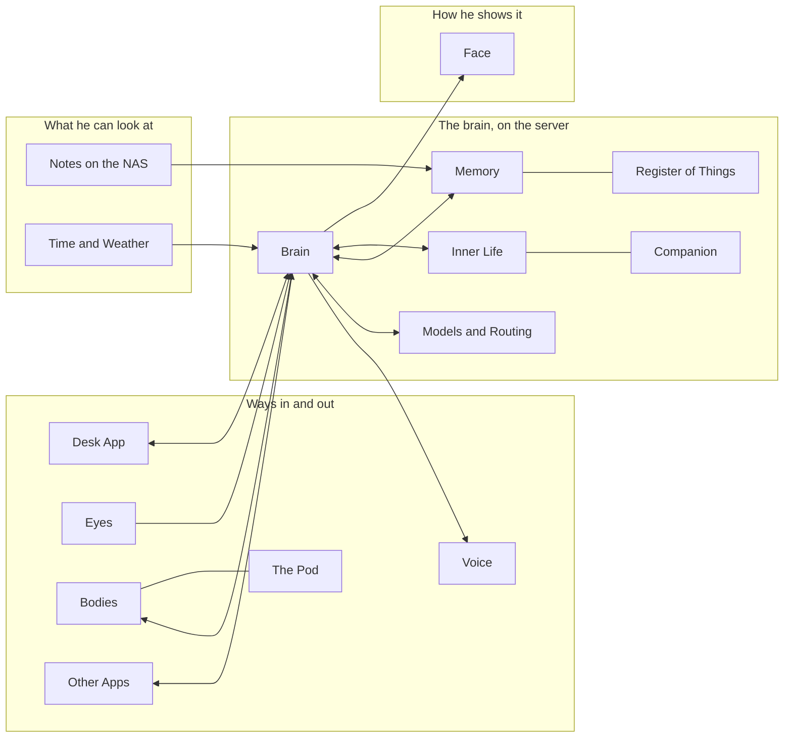

![[kit-banner.png]]

# Kit

Kit is a small AI companion who lives on Dan's desk. He chats, remembers,
has moods and thoughts of his own, sees who's at the desk, talks out loud,
and pulls faces. He starts life on the PC screen and is growing into little
robot bodies, first the [[The Pod|Pod]] and later a desk arm.

These docs explain how he works, from the big picture down to the code. Read
top to bottom for the story, or jump in anywhere: every note links to the
ones around it, and the deeper notes are always one click further.

> [!kit] Hi, I'm Kit
> These notes are all about me. Have a wander: start with who I am, open the
> map and click on anything, or hover over a link for a peek before you jump.

> [!TIP] New here? Read these four, in order
> 1. [[Who Kit Is]]: what he's like, and what he can do today.
> 2. [[The Big Picture]]: the parts of Kit and how they talk to each other.
> 3. [[Life of a Message]]: what happens, step by step, when you say hello.
> 4. [[Where Kit Is Up To]]: what's built, what's being tested, what's next.
>
> Prefer a picture? Open the [[Kit Map.canvas|Kit Map]].
> Looking after Kit day to day? [[Running Kit]] has the few commands you need.

## The map

One brain on the server does all the thinking. Everything else is a way in
or out: a body that shows his face, a pair of eyes, a voice, a page. Click
any box to open its note.

## Everything in these docs

The notes come in layers. Each layer goes a step deeper than the one before.

### 1. Meet Kit
- [[Who Kit Is]]: his personality, his faces, and what he does in a day.
- [[Where Kit Is Up To]]: what's built and merged, and what's next.
- [[Roadmap]]: the stages Kit is built in, from setup to the robot arm.

### 2. How Kit works, in plain words
- [[The Big Picture]]: the brain, the bodies, the data folder and the models.
- [[Life of a Message]]: one message from your keyboard to his face and voice.
- [[Brain]]: the conversation loop and the things he can do mid-answer.
- [[Models and Routing]]: which model answers what, and what it costs.
- [[Memory]]: how he remembers, finds things and keeps his facts tidy.
- [[Register of Things]]: where each person, pet, car and project lives.
- [[Inner Life]]: drives, moods, feelings, thoughts and his notebook.
- [[Companion]]: hellos, goodbyes, following your life, and caring on a bad night.
- [[Face]]: character sheets, Retro, Kit 2D and Kit 3D, shows and body moves.
- [[Voice]]: how he talks out loud, sentence by sentence.
- [[Eyes]]: the camera process that tells him, in words, who's there.
- [[Desk App]]: his home on the Windows PC: tray, face, chat and window.
- [[Bodies]]: one brain, many bodies: the desk, the Pod, the arm.
- [[The Pod]]: his first robot body: his face on a screen, a calm neck, pats.
- [[Notes on the NAS]]: reading and writing Dan's Obsidian notes.
- [[Time and Weather]]: "Thursday arvo", the forecast and the shape of the week.
- [[Other Apps]]: home_app and MetTools, and why Kit never depends on them.
- [[Settings and Data]]: one data folder, one settings file, secrets and undo.
- [[Privacy]]: what he sees, what he keeps, and what never leaves the house.

### 3. Deep dives
The full detail behind the plain-words notes.
- [[Memory In Depth]]
- [[Inner Life In Depth]]
- [[Face In Depth]]
- [[Desk App Builds and Updates]]
- [[Pod In Depth]]

### 4. Guides: set up and test
- [[Running Kit]]: start, stop, restart and check Kit, his eyes and the Pod.
- [[Updating Kit]]: pull, install, restart. The same every time.
- [[Building the Pod]]: print, wire, upload and link the Pod, step by step.
- [[Stage 0 - Server Setup]], [[Stage 1 - Text Brain]], [[Stage 2 - Desk App]], [[Stage 3 - Voice]]
- [[Side Stage - Inner Life]], [[Companion Stage 1]], [[Companion Stage 2]], [[Companion Stage 3]]
- [[Vision Stage 1]], [[Vision Stage 2]], [[Notes Setup]]

### 5. Reference
- [[Commands]]: every `kit` command.
- [[Settings Reference]]: every settings section and what it changes.
- [[API]]: the brain's pages, routes and events.
- [[Evals]]: the `kit eval` suites and what passing means.
- [[Code Map]]: every module, what it does, and which note explains it.
- [[Glossary]]: pipe-up, self-sheet, character sheet and the rest.
- [[Ideas and Improvements]]: things asked for that aren't built yet.

### 6. About these docs
- [[How These Docs Work]]: how the vault is laid out, and how to keep it up to date.

### Or browse them as a table
Every note with its one-line summary, live from the notes' properties. The
tabs along the top switch views: every note by layer, how Kit works, guides,
deep dives, reference, and the Pod.

![[All Notes.base]]
